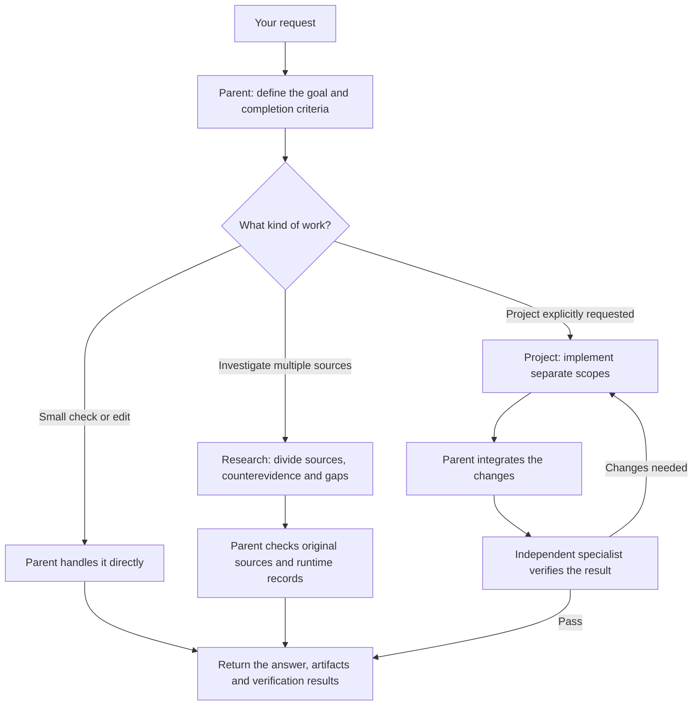
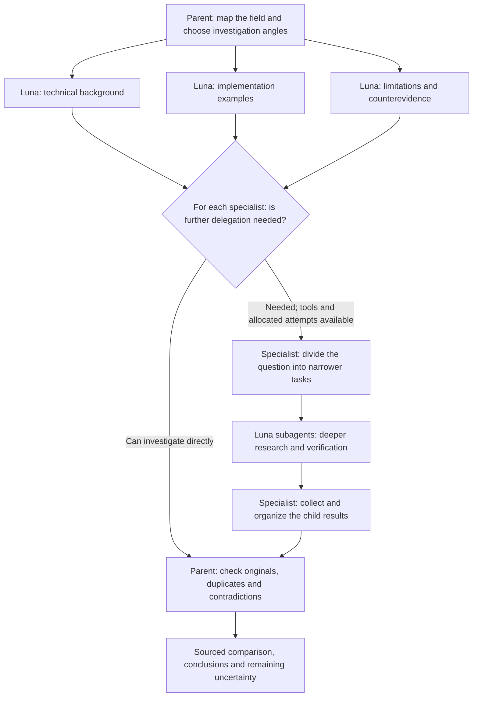
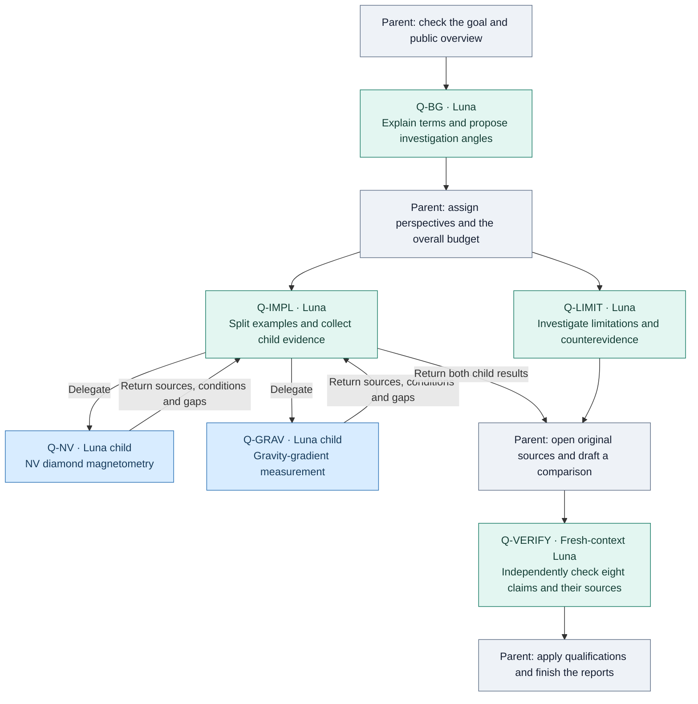
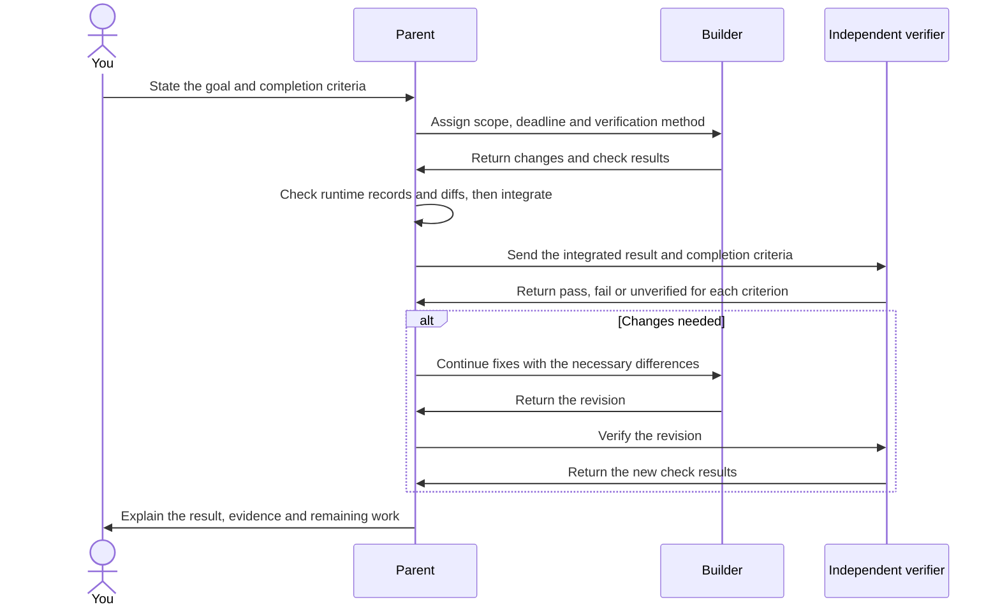

# Luna Research & Project Skills

**English** | [日本語](README.md)

[](https://github.com/dj-thank/luna-research-skills/actions/workflows/validate.yml)
[](https://github.com/dj-thank/luna-research-skills/releases)

Luna Research & Project Skills helps Codex divide research among agents, with each agent responsible for a different perspective.

When you explore an unfamiliar field, you may not yet know what questions to ask. These skills start with an overview, then split the investigation into perspectives such as technical background, implementation examples, and limitations. When needed, a specialist can delegate narrower questions to further subagents for deeper research and verification.

**Run GPT-6 Luna in parallel. Explore more perspectives and reach conclusions backed by sources.**

Evidence returns through the agents responsible for each perspective to the parent Codex agent. The parent checks the original sources and brings the findings together.

The default specialist model is **GPT-6 Luna / low**. Different specialists investigate official documentation, alternatives, counterevidence, and gaps. The parent keeps the model you selected. Sol specialists are available when explicitly requested.

This README describes the **main branch**. Release ZIPs contain the version fixed at each release. To try the current behavior, get main using the steps below. See the [changelog](CHANGELOG.md).

For an actual example, read the [quantum-sensor research findings](docs/quantum-sensors-research-2026-10-14.md) and the [six-Luna delegation and verification record](docs/luna-research-e2e-2026-10-14.md). Those detailed reports are currently in Japanese; this README explains the workflow and results in English.

## Start with these three choices

- **Investigate a topic** → `$run-diverse-luna-research`
- **Implement several parts and verify the result** → explicitly request `$run-diverse-luna-project`
- **Check something small or edit one file** → let the parent handle it directly

A skill is a set of working instructions that Codex reads when needed. The **parent** is the Codex agent receiving your request. A **specialist** is a separate agent it starts. Split the work where that helps the task.



## Why use Luna for parallel research?

The main benefit is **investigating different perspectives at the same time**. Give lower-cost Luna specialists bounded research questions and have them return findings and sources. The parent removes duplication, considers counterevidence, and decides what the evidence supports.



This diagram illustrates a possible division of work. Choose perspectives that fit the field. A specialist that needs to delegate receives child attempts and a permitted depth from the **same overall budget**. If the specialist cannot use delegation tools, the parent takes over the remaining work. Start at most three attempts in one batch. Multiple agents reading the same article do not create independent corroboration.

### The cost basis for exploring more perspectives

The official **additional-credit rates at Standard speed**, checked on October 14, 2026, were as follows. Values are credits per one million tokens.

| Model | Input | Cached input | Output |
|---|---:|---:|---:|
| GPT-6 Luna | 2.5 | 0.25 | 12.5 |
| GPT-6.1 Sol | 50 | 2.5 | 250 |
| GPT-6 Astra | 250 | 25 | 1,250 |

For equal amounts of non-cached input and output tokens, Luna's rates are **1/20 of Sol's** and **1/100 of Astra's**. This difference motivates the use of more investigation angles. See the [official rate table](https://learn.chatgpt.com/docs/pricing#token-rates).

Included plan limits are calculated separately and also depend on token volume, reasoning effort, speed settings, and tool use. Tokens are still consumed. Parallel work does not make usage zero, and total usage includes the parent's synthesis. The published Luna guidance for Plus / Standard Business is 350–3,000 local messages per five hours; this is an estimate, not a guaranteed allowance. See the [official usage limits](https://learn.chatgpt.com/docs/pricing#what-are-the-usage-limits-for-my-plan).

### Explicitly choosing Sol

Add “Use GPT-6.1 Sol / low for the specialists too” to your request. The parent specifies that model at dispatch and passes `--specialist-model gpt-6.1-sol` during verification. It does not accept Luna records as Sol records or switch to Sol automatically. See the [model selection policy](.agents/skills/run-diverse-luna-research/references/model-policy.md).

## What the skills do

| | Research: investigate | Project: build |
|---|---|---|
| Suitable tasks | Technical or literature research, comparisons, fact checks, counterevidence | Several features, audits with fixes, migrations, artifact creation |
| Specialists do | Collect primary sources, measurements, counterexamples, and missing evidence | Make changes within assigned files or worktrees |
| Parent checks | Original sources, differing conditions, duplication, contradictions, and unknowns | Actual diffs, integration, tests, and independent verification |
| You receive | Sourced conclusions, comparisons, and remaining uncertainty | Delivered changes, verification results, and remaining work |

Research specialists return evidence. When research supports implementation, the parent remains responsible for implementation and final integration. To use Project delegation, explicitly name the skill or request implementation divided among Luna agents.

## Step 1: check the environment

You need:

1. A Codex environment that supports local skills and subagents.
2. An account and workspace with access to GPT-6 Luna.
3. **Python 3.11 or later**, for the configuration and runtime-record checkers.
4. Git, if you clone the repository.
5. Search and page-fetch tools, with permission to use them, for web research.

Check your Python version. The examples use `python`; replace it with the command that selects Python 3.11 or later in your environment.

```sh
python --version
```

Installing a skill does not grant access to extra models, tools, or permissions. If a required delegation route is unavailable, the parent explains the reason and continues the work it can perform.

## Step 2: get the repository and open it in Codex

```sh
git clone https://github.com/dj-thank/luna-research-skills.git
cd luna-research-skills
```

**Open this folder as a Codex project and start a new chat.** The two skills under `.agents/skills` are available within this repository.

If you already have skills with the same names installed at user scope, check which copy is selected. Record its location and compare differing copies before using them together. See [installation and updates](docs/INSTALLATION.md).

```text
luna-research-skills/
├─ .agents/skills/
│  ├─ run-diverse-luna-research/   Research instructions
│  └─ run-diverse-luna-project/    Implementation and verification instructions
├─ .codex/agents/                 Optional custom roles
├─ tools/                        Installation and verification tools
└─ docs/                         Detailed guides and evaluation records
```

The standard route uses the built-in `default` or `worker` role with an explicit model, reasoning effort, and fresh context. Custom roles under `.codex/agents` are optional. A role name alone does not establish the model actually used or the tools available. See the [official skill-loading rules](https://learn.chatgpt.com/docs/build-skills#where-codex-loads-local-skills).

### Using the skills in other projects

From the cloned folder, first preview the destination and planned changes:

```sh
python tools/install_luna_skills.py
```

After reviewing the plan, install and verify. These commands work on macOS, Linux, and Windows.

```sh
python tools/install_luna_skills.py --apply
python tools/install_luna_skills.py --verify
```

The destination is `$HOME/.agents/skills`. The installer does not change the parent model or global configuration. **It stops if a skill with the same name already exists.** Check local changes and the destination before updating. The [detailed installation guide](docs/INSTALLATION.md) covers Windows migration, Cloud, and plugin ZIPs.

### Updating an existing installation

1. Run `git status --short` in your existing clone. Preserve local changes before updating.
2. Update a clean source checkout to the latest main:

   ```sh
   git switch main
   git pull --ff-only
   ```

3. For repository-scoped use, reopen this folder in Codex. For user-scoped use, compare and back up the installed copy, then follow the [existing-skill update procedure](docs/INSTALLATION.md#既存スキルを更新する). The installer does not overwrite an existing copy.
4. Start a new chat and repeat the readiness check below. `git pull` cannot update an old Release ZIP; get the newer source in a separate folder and compare it.

## Step 3: check readiness

Run this from the repository root:

```sh
python .agents/skills/run-diverse-luna-research/scripts/check_setup.py --agent-role default --allow-generic-worker
```

`READY` means the available preparation checks, such as saved configuration, passed. **The next step obtains evidence that a child actually ran.**

The skill's setup checker requires delegation to be enabled and the child concurrency limit to be **2–6**. If you need to adjust the configuration, the following is an example. Inspect an existing `[agents]` section first and edit it without adding a duplicate section.

```toml
[agents]
enabled = true
max_concurrent_threads_per_session = 6
```

These are the skill's delegation requirements, separate from Codex's own defaults. The installer does not apply this configuration. The model and reasoning effort are set on each dispatch, so the parent model does not need to change. See the [official subagent settings](https://learn.chatgpt.com/docs/agent-configuration/subagents#global-settings).

If a Windows command fails or configuration disagrees with CLI output, use the [environment checks](.agents/skills/run-diverse-luna-research/references/environment-check.md). Distinguish another execution account, Python, or sandbox from the current chat. Add `--require-v2` only when the run requires V2.

## Step 4: send your first request

### Request research

```text
$run-diverse-luna-research
I want to learn about quantum sensors, but I do not yet know what to investigate.
First map the field, explain the key terms, and choose perspectives such as
background, implementation examples, and limitations.
Assign each perspective to a specialist. Where needed, let specialists delegate
narrower research and verification tasks to subagents.
Return a sourced comparison and explain what is still unknown.
```

Adding the decision you want to make helps narrow the scope. Specialists take different questions, and the parent checks original sources. Reposts of the same announcement do not count as independent evidence.

### An actual run of the research example

On October 14, 2026, we ran the **Japanese version** of the quantum-sensor request against public sources. We started **six GPT-6 Luna / low agents in total**, including two children started by the implementation specialist. The run completed delegation, evidence collection, and independent verification in a fresh context.

| Read | Contents |
|---|---|
| [Quantum-sensor findings](docs/quantum-sensors-research-2026-10-14.md) — Japanese | Overview, terms, NV magnetometry and gravity-gradient examples, comparison conditions, and unknowns |
| [Six-agent execution walkthrough](docs/luna-research-e2e-2026-10-14.md) — Japanese | Assigned work, child delegation and collection, verification results, operational corrections, and tested scope |
| [Public execution summary JSON](docs/luna-research-e2e-2026-10-14.json) | Parent–child relationships, verified specialist models, eight claim verdicts, sources, and access scope |



All parent steps belong to the same Codex agent. Q-IMPL is the same specialist when delegating and collecting results. The six Luna agents exclude the parent. **Peak observed child concurrency was three, and the observed depth was two.** The parent opened seven documents. Independent verification returned five `PASS` and three `QUALIFY` verdicts for eight claims, and the parent applied the required wording qualifications.

This verifies the actual Codex research workflow and literature investigation. It does not establish physical replication of sensor experiments or reductions in billing or plan usage. The public JSON summarizes locally checked runtime records; it cannot independently replay the private raw-record verification.

### Request implementation

```text
$run-diverse-luna-project
Add a data export feature to this web service.
Divide the API and UI work, preserve existing changes, and continue through
implementation, integration, and independent verification.
The completion criterion is: a user can download a CSV from the UI,
and its contents have been verified.
```

State what to build and how completion will be checked. Keep overlapping edits, device operations, and authenticated service operations under one owner. Use `followup_task` to continue fixes with an existing specialist, and a different specialist for independent final verification.



## Step 5: check the results

Review the following alongside the answer or artifacts:

| Evidence | What it establishes |
|---|---|
| Sources and actual changes | The substance supporting the findings or delivery |
| A child's completed-turn runtime record | Actual model, reasoning effort, and completion |
| The parent's dispatch record | Which request and route started the child |
| Verification for each criterion | What passed and what remains unverified |

After identifying the exact child UUID, completed-turn UUID, and dispatch record, the parent can check them with:

```sh
python .agents/skills/run-diverse-luna-research/scripts/check_setup.py --agent-role default --allow-generic-worker --runtime-thread <child-uuid> --runtime-turn <completed-turn-uuid> --parent-rollout <actual-root.jsonl> --require-spawn-provenance
```

Replace `<...>` with observed values. You can ask Codex to find and verify them. The parent checks completion records after the child finishes; the child does not need to produce its own future completion record before starting.

This dispatch check applies to the **first child turn**. Later `followup_task` turns require continuation records; the initial dispatch alone does not prove those later turns. A complete Research or Project run also verifies the **ledger** of assignments, results, and evidence. See the execution contract in each skill.

### Check what a pass covers

| Gate | Scope |
|---|---|
| `LOCAL_PASS` | Local artifacts and tests |
| `DEVICE_PASS` | Operation on an actual device |
| `PROVIDER_PASS` | Operation in an external service |
| `PUBLIC_PASS` | Readback of the published result |
| `HUMAN_GO` | Required human approval |

The required gates depend on the task. Local tests alone do not establish device or public-environment success. Sending, publishing, purchasing, deleting, and deploying remain within the user's authorized scope. See [permissions and data handling](SECURITY.md).

## Keeping delegation bounded

The standard starting point is **one or two specialists assigned directly by the parent**. The entire run shares these budgets:

| Symbol | Meaning | Skill policy |
|---|---|---|
| `N` | Total attempts, including starts, continuations, failures, and retries | Default 6, maximum 12 |
| `C` | Maximum children open concurrently | At most 6, within the runtime's limit |
| `W` | Attempts started in one batch | Usually 1–2, at most 3 |
| `V` | Attempts reserved for necessary independent verification | `max(1, ceil(0.15 × N))` |

Before dispatch, `check_dispatch_budget.py` counts actual calls. Children, retries, and continuations do not receive new budgets. If the budget is exhausted, the parent completes necessary remaining work. Bounded dispatch alone does not guarantee faster results or a particular usage reduction.

For larger tasks, a coordinator may delegate further when its actual tools support it and the work has an allocation within the same budget. Start with direct delegation and use the [recursive delegation contract](.agents/skills/run-diverse-luna-research/references/recursive-delegation.md) when a hierarchy is needed. Configurations with an Astra coordinator follow the [explicit model policy](.agents/skills/run-diverse-luna-research/references/model-policy.md).

## What has been verified?

The checker distinguishes the current Luna route from an explicitly selected Sol route by comparing configuration, runtime records, and parent dispatch records. Public regression tests and CI check model mix-ups, acceptance of Sol without explicit selection, and concurrency-limit violations.

The [six-agent quantum-sensor record](docs/luna-research-e2e-2026-10-14.md) covers actual research, independent verification, and synthesis. The [Luna policy verification](docs/luna-first-2026-10-14.md) records the runtime observations made when the model policy was updated. The [unfamiliar-field and child-delegation check](docs/unknown-field-research-2026-10-14.md) records a Luna specialist starting a Luna child and collecting evidence. The [earlier Sol compatibility check](docs/compatibility-2026-10-14.md) and [September 5, 2026 evaluation](docs/research-evaluation-2026-09-05.md) remain records of the models used at those times. Historical success does not prove execution with a different model.

## Troubleshooting

| Situation | What to check |
|---|---|
| Skill does not appear | Correct project folder and a new chat |
| `destination already exists` | Existing-skill protection: compare changes and ownership before retrying |
| Model cannot start | Current model availability and account access; no automatic model substitution |
| Readiness and execution disagree | Saved configuration, another CLI, and the current chat's tools and runtime records |
| A child cannot delegate further | Its actual tools; consider direct delegation by the parent |
| `yaml` format validation fails | The exact validation Python and PyYAML installation, including sandbox/account differences |

The Python installer, runtime checkers, and regression tests use the standard library. The developer-facing Skill Creator format validator also needs PyYAML. See the [environment checks](.agents/skills/run-diverse-luna-research/references/environment-check.md).

## Further reading

| Resource | When to read it |
|---|---|
| [Research skill](.agents/skills/run-diverse-luna-research/SKILL.md) / [Project skill](.agents/skills/run-diverse-luna-project/SKILL.md) | Follow the detailed working instructions |
| [Quantum-sensor findings](docs/quantum-sensors-research-2026-10-14.md) — Japanese | Read a real investigation with sources |
| [Six-agent delegation and verification](docs/luna-research-e2e-2026-10-14.md) — Japanese | See the actual execution sequence and tested scope |
| [Installation and updates](docs/INSTALLATION.md) | Use another project, Windows migration, Cloud, or a plugin |
| [Compatibility verification](docs/compatibility-2026-10-14.md) — Japanese | Compare observed results with untested boundaries |
| [Development and verification](CONTRIBUTING.md) | Change code or skills |
| [Changelog](CHANGELOG.md) | Understand differences between main and releases |
| [Official subagent documentation](https://learn.chatgpt.com/docs/agent-configuration/subagents) | Check Codex settings, model resolution, and permissions |

This is a community-maintained skill collection, licensed under [MIT](LICENSE).
