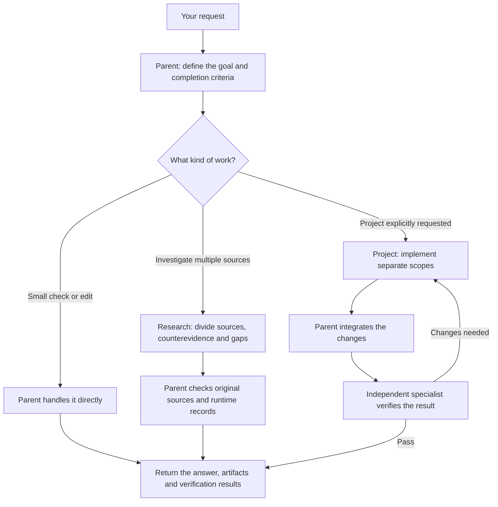
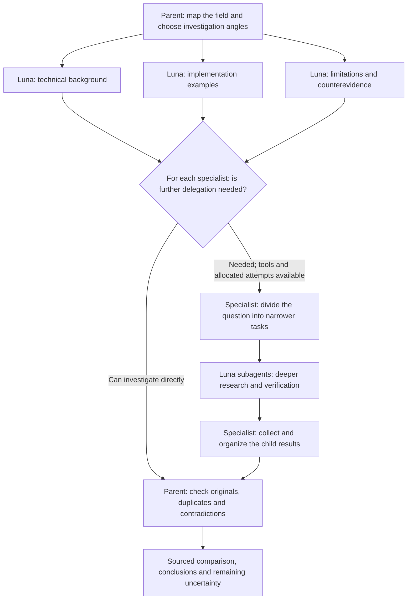
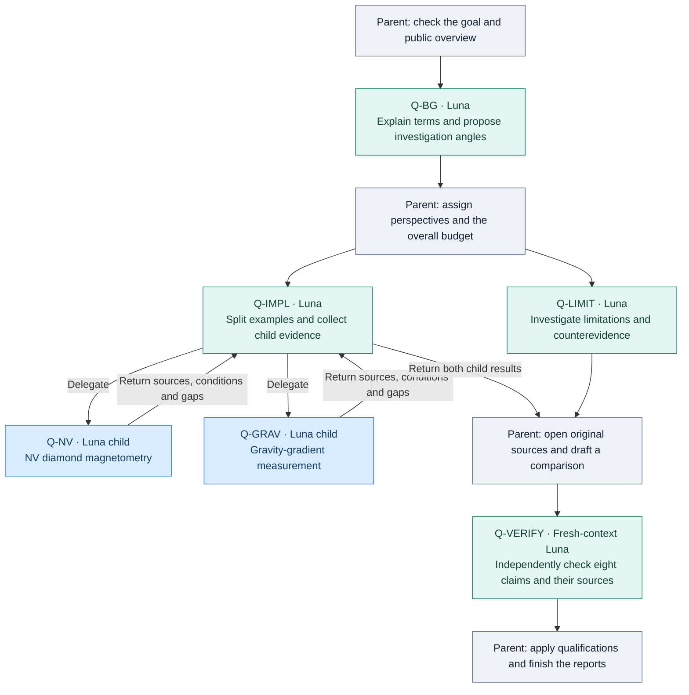
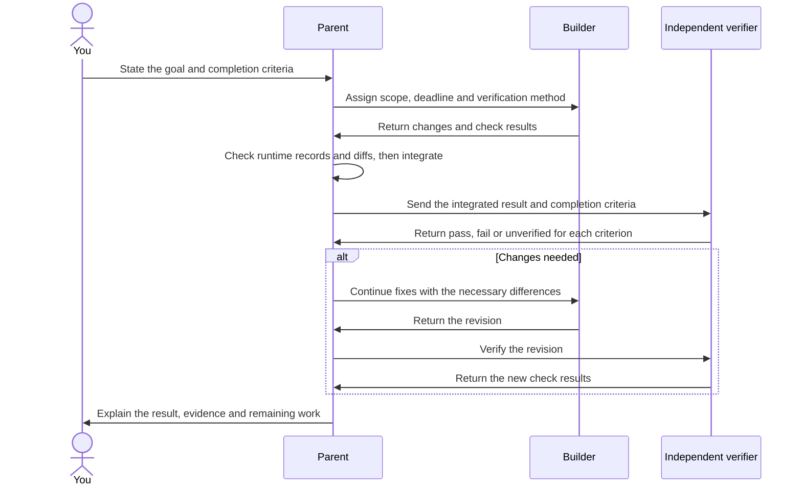

# Luna Research & Project Skills

**English** | [日本語](README.md)

[](https://github.com/dj-thank/luna-research-skills/actions/workflows/validate.yml)
[](https://github.com/dj-thank/luna-research-skills/releases)

**Codex skills for delegating research and implementation, checking evidence, and integrating verified results.**

Research investigates primary sources, alternatives and counterevidence. Project divides implementation ownership, integrates changes and verifies the result. The parent Codex agent manages completion criteria, the shared attempt budget and acceptance. Small tasks stay with the parent.

The public skills default to **GPT-6 Luna / low** and support **GPT-6.1 Sol / low** when explicitly selected. The parent keeps your chosen model. These are working instructions and verification tools, not a standalone background service.

This README describes the **main branch**. Release ZIPs contain the version fixed at each release. To try the current behavior, get main using the steps below. See the [changelog](CHANGELOG.md).

For an actual example, read the [quantum-sensor research findings](docs/quantum-sensors-research-2026-10-14.md) and the [six-Luna delegation and verification record](docs/luna-research-e2e-2026-10-14.md). Those detailed reports are currently in Japanese; this README explains the workflow and results in English.

## Quick start

Use Git, Python 3.11 or newer, and a Codex environment with access to subagents and the selected specialist model.

```sh
git clone https://github.com/dj-thank/luna-research-skills.git
cd luna-research-skills
```

Open this folder in Codex and request `$run-diverse-luna-research` or `$run-diverse-luna-project`, with your goal and completion criteria. Trying the skills inside this repository does not require a user-scope installation.

| OS | Check Python | Check readiness |
|---|---|---|
| Windows (PowerShell) | `py -3 --version` | `py -3 .agents/skills/run-diverse-luna-research/scripts/check_setup.py --agent-role default --allow-generic-worker` |
| macOS / Linux | `python3 --version` | `python3 .agents/skills/run-diverse-luna-research/scripts/check_setup.py --agent-role default --allow-generic-worker` |

Replace `python` in subsequent examples with the command for Python 3.11 or newer on your system. If readiness fails, follow [Step 3](#step-3-check-readiness). `READY` describes preparation; it does not prove that a child has run.

| Goal | Start here |
|---|---|
| Write a first request | [Research and implementation examples](#step-4-send-your-first-request) |
| Install or update for another project | [Cross-platform installation and Windows migration](docs/INSTALLATION.md) |
| Inspect dispatch, dependencies and retries | [Swarm operation and Planner 1.2](.agents/skills/run-diverse-luna-project/references/swarm-coordination.md) |
| Try evaluation without starting agents | [Reproduce the comparisons](#reproduce-the-comparisons) |
| Contribute changes | [Development and verification](CONTRIBUTING.md) |

## Start with these three choices

- **Investigate a topic** → `$run-diverse-luna-research`
- **Implement several parts and verify the result** → explicitly request `$run-diverse-luna-project`
- **Check something small or edit one file** → let the parent handle it directly

A skill is a set of working instructions that Codex reads when needed. The **parent** is the Codex agent receiving your request. A **specialist** is a separate agent it starts. Split the work where that helps the task.



## Why use Luna for parallel research?

The main benefit is **investigating different perspectives at the same time**. Give specialists bounded research questions and have them return findings and sources. The parent removes duplication, considers counterevidence, and decides what the evidence supports.



This diagram illustrates a possible division of work. Choose perspectives that fit the field. A specialist that needs to delegate receives child attempts and a permitted depth from the **same overall budget**. If the specialist cannot use delegation tools, the parent takes over the remaining work. Start at most three attempts in one batch. Multiple agents reading the same article do not create independent corroboration.

### Check usage and cost

Compare total work, including parent investigation and integration, retries and verification. This repository's synthetic benchmarks do not establish real speed, cost or quota savings. Check current conditions in the [official pricing](https://learn.chatgpt.com/docs/pricing#token-rates) and [plan limits](https://learn.chatgpt.com/docs/pricing#what-are-the-usage-limits-for-my-plan).

### Explicitly choosing Sol

Add “Use GPT-6.1 Sol / low for the specialists too” to your request. The parent specifies that model at dispatch and passes `--specialist-model gpt-6.1-sol` during verification. It does not accept Luna records as Sol records or switch to Sol automatically. See the [model selection policy](.agents/skills/run-diverse-luna-research/references/model-policy.md).

## What the skills do

| | Research: investigate | Project: build |
|---|---|---|
| Suitable tasks | Technical or literature research, comparisons, fact checks, counterevidence | Several features, audits with fixes, migrations, artifact creation |
| Specialists do | Collect primary sources, measurements, counterexamples, and missing evidence | Make changes within assigned files or worktrees |
| Parent checks | Original sources, differing conditions, duplication, contradictions, and unknowns | Actual diffs, integration, tests, and independent verification |
| You receive | Sourced conclusions, comparisons, and remaining uncertainty | Delivered changes, verification results, and remaining work |

Research specialists return evidence. When research supports implementation, the parent remains responsible for implementation and final integration. To use Project delegation, explicitly name the skill or request implementation divided among Luna agents.

## Step 1: check the environment

You need:

1. A Codex environment that supports local skills and subagents.
2. An account and workspace with access to GPT-6 Luna, or explicitly selected GPT-6.1 Sol.
3. **Python 3.11 or later**, for the configuration and runtime-record checkers.
4. Git, if you clone the repository.
5. Search and page-fetch tools, with permission to use them, for web research.

Check your Python version. The examples use `python`; replace it with the command that selects Python 3.11 or later in your environment.

```sh
python --version
```

Installing a skill does not grant access to extra models, tools, or permissions. If a required delegation route is unavailable, the parent explains the reason and continues the work it can perform.

## Step 2: get the repository and open it in Codex

```sh
git clone https://github.com/dj-thank/luna-research-skills.git
cd luna-research-skills
```

**Open this folder as a Codex project and start a new chat.** The two skills under `.agents/skills` are available within this repository.

If you already have skills with the same names installed at user scope, check which copy is selected. Record its location and compare differing copies before using them together. See [installation and updates](docs/INSTALLATION.md).

```text
luna-research-skills/
├─ .agents/skills/
│  ├─ run-diverse-luna-research/   Research instructions
│  └─ run-diverse-luna-project/    Implementation and verification instructions
├─ .codex/agents/                 Optional custom roles
├─ tools/                        Installation and verification tools
└─ docs/                         Detailed guides and evaluation records
```

The standard route uses the built-in `default` or `worker` role with an explicit model, reasoning effort, and fresh context. Custom roles under `.codex/agents` are optional. A role name alone does not establish the model actually used or the tools available. See the [official skill-loading rules](https://learn.chatgpt.com/docs/build-skills#where-codex-loads-local-skills).

### Using the skills in other projects

From the cloned folder, first preview the destination and planned changes:

```sh
python tools/install_luna_skills.py
```

After reviewing the plan, install and verify. These commands work on macOS, Linux, and Windows.

```sh
python tools/install_luna_skills.py --apply
python tools/install_luna_skills.py --verify
```

The destination is `$HOME/.agents/skills`. The installer does not change the parent model or global configuration. **It stops if a skill with the same name already exists.** Check local changes and the destination before updating. The [detailed installation guide](docs/INSTALLATION.md) covers Windows migration, Cloud, and plugin ZIPs.

### Updating an existing installation

1. Run `git status --short` in your existing clone. Preserve local changes before updating.
2. Update a clean source checkout to the latest main:

   ```sh
   git switch main
   git pull --ff-only
   ```

3. For repository-scoped use, reopen this folder in Codex. For user-scoped use, compare and back up the installed copy, then follow the [existing-skill update procedure](docs/INSTALLATION.md#既存スキルを更新する). The installer does not overwrite an existing copy.
4. Start a new chat and repeat the readiness check below. `git pull` cannot update an old Release ZIP; get the newer source in a separate folder and compare it.

## Step 3: check readiness

Run this from the repository root:

```sh
python .agents/skills/run-diverse-luna-research/scripts/check_setup.py --agent-role default --allow-generic-worker
```

`READY` means the available preparation checks, such as saved configuration, passed. **The next step obtains evidence that a child actually ran.**

The skill's setup checker requires delegation to be enabled and the child concurrency limit to be **2–6**. If you need to adjust the configuration, the following is an example. Inspect an existing `[agents]` section first and edit it without adding a duplicate section.

```toml
[agents]
enabled = true
max_concurrent_threads_per_session = 6
```

These are the skill's delegation requirements, separate from Codex's own defaults. The installer does not apply this configuration. The model and reasoning effort are set on each dispatch, so the parent model does not need to change. See the [official subagent settings](https://learn.chatgpt.com/docs/agent-configuration/subagents#global-settings).

If a Windows command fails or configuration disagrees with CLI output, use the [environment checks](.agents/skills/run-diverse-luna-research/references/environment-check.md). Distinguish another execution account, Python, or sandbox from the current chat. Add `--require-v2` only when the run requires V2.

## Step 4: send your first request

### Request research

Start with a bounded decision and two alternatives:

```text
$run-diverse-luna-research
Help me choose SQLite or PostgreSQL for a small personal app.
Use public official sources and the stable versions available on the research date.
Compare setup effort, backups, and concurrent-update constraints.
Return a comparison table, sources, and unknowns. Divide only useful independent
questions; recursive delegation is unnecessary for this request.
```

If a short parent-only check can answer the question, the parent answers directly. For a broader unfamiliar field, use a request like this:

```text
$run-diverse-luna-research
I want to learn about quantum sensors, but I do not yet know what to investigate.
First map the field, explain the key terms, and choose perspectives such as
background, implementation examples, and limitations.
Assign each perspective to a specialist. Where needed, let specialists delegate
narrower research and verification tasks to subagents.
Return a sourced comparison and explain what is still unknown.
```

Adding the decision you want to make helps narrow the scope. Specialists take different questions, and the parent checks original sources. Reposts of the same announcement do not count as independent evidence.

### An actual run of the research example

On October 14, 2026, we ran the **Japanese version** of the quantum-sensor request against public sources. We started **six GPT-6 Luna / low agents in total**, including two children started by the implementation specialist. The run completed delegation, evidence collection, and independent verification in a fresh context.

| Read | Contents |
|---|---|
| [Quantum-sensor findings](docs/quantum-sensors-research-2026-10-14.md) — Japanese | Overview, terms, NV magnetometry and gravity-gradient examples, comparison conditions, and unknowns |
| [Six-agent execution walkthrough](docs/luna-research-e2e-2026-10-14.md) — Japanese | Assigned work, child delegation and collection, verification results, operational corrections, and tested scope |
| [Public execution summary JSON](docs/luna-research-e2e-2026-10-14.json) | Parent–child relationships, verified specialist models, eight claim verdicts, sources, and access scope |



All parent steps belong to the same Codex agent. Q-IMPL is the same specialist when delegating and collecting results. The six Luna agents exclude the parent. **Peak observed child concurrency was three, and the observed depth was two.** The parent opened seven documents. Independent verification returned five `PASS` and three `QUALIFY` verdicts for eight claims, and the parent applied the required wording qualifications.

This verifies the actual Codex research workflow and literature investigation. It does not establish physical replication of sensor experiments or reductions in billing or plan usage. The public JSON summarizes locally checked runtime records; it cannot independently replay the private raw-record verification.

### Request implementation

```text
$run-diverse-luna-project
Add a data export feature to this web service.
Divide the API and UI work, preserve existing changes, and continue through
implementation, integration, and independent verification.
The completion criterion is: a user can download a CSV from the UI,
and its contents have been verified.
```

State what to build and how completion will be checked. Keep overlapping edits, device operations, and authenticated service operations under one owner. Use `followup_task` to continue fixes with an existing specialist, and a different specialist for independent final verification.



### Reduce swarm waiting and ownership conflicts

Run an API workstream and an independent documentation workstream together. Once the parent accepts the API result, the UI workstream can start from that exact revision while documentation continues. A fresh verifier later checks the same root-integrated candidate.

Pin dependency revisions, assign disjoint edits, and identify shared-device owners. After a timeout, verify that the previous writer can no longer affect the resource before handing it over. The ledger checks ownership conflicts and retry ordering; it cannot prove that a process stopped or that delivery became faster. See the [practical swarm coordination example](.agents/skills/run-diverse-luna-project/references/swarm-coordination.md) for readiness and stale-result handling.

The bundled `plan_swarm.py` reads a flat Project v2 ledger and returns a proposed next batch plus review, dependency, ownership, capacity and integration blockers as JSON. It does not modify the ledger or start agents. See [planner usage](.agents/skills/run-diverse-luna-project/references/swarm-coordination.md#inspect-the-next-batch).

Planner 1.2 adds `dependency_replacement_hints` when a consumer still depends on a failed attempt with an accepted retry. The parent checks the artifact and consumer contract before updating that dependency. Hints leave deadline, capacity and access restrictions in place; they never replace an input automatically.

Feed actual dispatch and verified results back into the ledger. Run `python tools/benchmark_swarm.py` against predeclared answers and follow the [swarm evaluation and improvement procedure](docs/swarm-experiments.md) for communication experiments and native repair trials. For an explicitly selected Sol run, pass `--specialist-model gpt-6.1-sol` to the planner as well.

### Turn research into improvements

```text
Examine this repository from the user, research-quality, and maintainer perspectives.
For each improvement, give the evidence, affected files, acceptance check,
and the strongest reason to leave it unchanged.
Select supported, useful changes, then implement and verify them while preserving existing behavior.
```

Evidence scouts return sources and proposals; the parent owns selection, implementation, and verification. Use the [implementation handoff example](.agents/skills/run-diverse-luna-research/references/workflow.md#handoff-to-authorized-implementation) to connect each change to evidence and an observable check. Explicitly select the Project workflow as well when you want delegated implementation.

## Step 5: check the results

Review the following alongside the answer or artifacts:

| Evidence | What it establishes |
|---|---|
| Sources and actual changes | The substance supporting the findings or delivery |
| A child's completed-turn runtime record | Actual model, reasoning effort, and completion |
| The parent's dispatch record | Which request and route started the child |
| Verification for each criterion | What passed and what remains unverified |

After identifying the exact child UUID, completed-turn UUID, and dispatch record, the parent can check them with:

```sh
python .agents/skills/run-diverse-luna-research/scripts/check_setup.py --agent-role default --allow-generic-worker --runtime-thread <child-uuid> --runtime-turn <completed-turn-uuid> --parent-rollout <actual-root.jsonl> --require-spawn-provenance
```

Replace `<...>` with observed values. You can ask Codex to find and verify them. The parent checks completion records after the child finishes; the child does not need to produce its own future completion record before starting.

This dispatch check applies to the **first child turn**. Later `followup_task` turns require continuation records; the initial dispatch alone does not prove those later turns. A complete Research or Project run also verifies the **ledger** of assignments, results, and evidence. See the execution contract in each skill.

### Check what a pass covers

| Gate | Scope |
|---|---|
| `LOCAL_PASS` | Local artifacts and tests |
| `DEVICE_PASS` | Operation on an actual device |
| `PROVIDER_PASS` | Operation in an external service |
| `PUBLIC_PASS` | Readback of the published result |
| `HUMAN_GO` | Required human approval |

The required gates depend on the task. Local tests alone do not establish device or public-environment success. Sending, publishing, purchasing, deleting, and deploying remain within the user's authorized scope. See [permissions and data handling](SECURITY.md).

## Keeping delegation bounded

The standard starting point is **one or two specialists assigned directly by the parent**. The entire run shares these budgets:

| Symbol | Meaning | Skill policy |
|---|---|---|
| `N` | Total attempts, including starts, continuations, failures, and retries | Default 6, maximum 12 |
| `C` | Maximum children open concurrently | At most 6, within the runtime's limit |
| `W` | Attempts started in one batch | Usually 1–2, at most 3 |
| `V` | Attempts reserved for necessary independent verification | `max(1, ceil(0.15 × N))` |

Before dispatch, `check_dispatch_budget.py` counts actual calls. Children, retries, and continuations do not receive new budgets. If the budget is exhausted, the parent completes necessary remaining work. Bounded dispatch alone does not guarantee faster results or a particular usage reduction.

For larger tasks, a coordinator may delegate further when its actual tools support it and the work has an allocation within the same budget. Start with direct delegation and use the [recursive delegation contract](.agents/skills/run-diverse-luna-research/references/recursive-delegation.md) when a hierarchy is needed. Configurations with an Astra coordinator follow the [explicit model policy](.agents/skills/run-diverse-luna-research/references/model-policy.md).

## What has been verified?

| Evidence | Current scope | What it does not establish |
|---|---|---|
| OS CI | Windows, macOS and Linux with Python 3.11–3.13; Windows migration checks also cover PowerShell 5.1/7 | Success in every user environment or with every current model |
| Installation and packaging | Existing-copy protection, isolated installation/readback, reproducible ZIPs | Automatic updates to a user's installed copies |
| Ledger and planner | Dependencies, ownership conflicts, budgets, deadlines, retries and acceptance records | Process termination or enforced filesystem locks |
| Known-answer comparisons | The tools below retain outcomes and unsuccessful comparison policies | LLM reasoning gains or real task speed/cost savings |
| Actual agent records | Published examples identify their date, model and evidence | Unconditional transfer to another environment or model |

### Reproduce the comparisons

Run from the repository or source ZIP root. The plugin ZIP includes the answer fixtures but not the evaluation scripts. These local evaluations use synthetic inputs; they do not start child agents or operate external services.

```sh
python tools/benchmark_swarm.py
python tools/benchmark_review.py
python tools/benchmark_communication.py
python tools/benchmark_delivery.py
```

| Command | Comparison |
|---|---|
| `benchmark_swarm.py` | Next assignments and blocker reasons for 18 states, plus communication recipients |
| `benchmark_review.py` | Critique, minority proposals and duplicate evaluation reuse on 12 cases with the same two-call ceiling |
| `benchmark_communication.py` | Run identity, epoch and recipient input contracts on 14 delivery cases |
| `benchmark_delivery.py` | Lost deliveries/ACKs and transactional SQLite receipt/effect deduplication on 18 cases |

Before freezing generated comparison data, [check construction order and separately reviewed answers](docs/fixture-integrity.md) to detect cross-case mutation. Matching hashes cannot detect corruption that happened before the snapshot was frozen.

For evidence spread across original registers, [name each requirement's required sources](docs/cross-source-requirements.md). The reader preserves values, qualifiers and source attribution, and detects declared conflicts, unknowns and missing records without substituting one favorable source for another.

For time-dependent questions, [declare the question's time and validity windows](docs/temporal-requirements.md) to diagnose expired, future or unknown intervals while retaining valid historical answers. This does not verify current provider state or the truth of the recorded windows.

When observation age matters, [declare a maximum age](docs/observation-freshness.md) at the same question clock. The reader checks the selected observation timestamp without substituting a newer receipt timestamp.

Each emits JSON and exits nonzero when results disagree with the frozen expectations. An alternative policy's incorrect answer can itself be an expected experimental result. The [evaluation and adoption guide](docs/swarm-experiments.md) explains fixed answers, preserved failures and reopening actual artifacts.

For your own comparisons, follow the [report checking guide](docs/comparison-reports.md). `check_comparison.py` checks separately pinned evidence for per-case losses, omitted calibration calls and changed inputs. Report consistency and policy adoption are separate decisions.

Use the [review evidence producer](docs/comparison-reports.md#export-a-review-comparison-without-hand-counting-checks) to export the existing benchmark directly. It counts actual evaluation attempts, distinguishes cache reuse from failures, and refuses a complete export when the run is incomplete.

The saving example validates evidence, digest and report before publishing an `accepted` directory. It retains interrupted `.pending` files and refusal audits and never overwrites an earlier run.

The [recovery inspector](docs/comparison-recovery.md) checks a trusted evidence pin and distinguishes complete published, complete staged, incomplete and conflicting runs. It is read-only and never reruns, publishes or deletes anything.

For a narrow decision over large evidence, use the [on-demand handoff](docs/on-demand-evidence.md). It verifies approved request/source pins and returns exact answers with mandatory qualifications and pending status. Keep the original source and distinguish exposed context from actual source bytes read.

For evidence organized by subject and requirement, try [requirement-driven selection](docs/requirement-selection.md). Root reviews the question's answer requirements and guards; the reader returns every matching observation with its qualifiers. Missing, unknown or conflicting evidence is insufficient, and successful records for another subject cannot fill a gap. Root still checks the meaning and completeness of the requirement set.

Optionally declare [relationships between requirements](docs/requirement-selection.md#optional-relationships-between-requirements) to check matching revisions/artifacts and coverage of required targets. These checks add context bytes, so include the relationships needed for the decision.

For handoffs, [define the receiving question before reviewing the sender's checklist](docs/receiver-questions.md). Two executable examples over the same evidence show why all declared checks can match while a necessary check is omitted.

The [actual external repair example](docs/external-task-evaluation.md) executes a more-itertools bug fix, retains a rejected patch that breaks existing behavior, and verifies the final repair against 12 behavior checks and 905 upstream tests. Replay the real receipts to see how explicit regression obligations improve handoff diagnostics, with the evaluation limits stated.

A [second task checks the imported code scope](docs/execution-scope-evaluation.md): changing a helper causes five failures while the primary source stays identical. Comparing the three executed package files detects a replay of an earlier passing receipt.

An [input/configuration task in another repository](docs/configuration-scope-evaluation.md) executes six python-dotenv cases. Identical code behaves differently with changed input, environment values or override settings; manifest binding detects three replays of a passing receipt.

A [file-effects and recovery task](docs/artifact-effects-evaluation.md) reproduces write failures hidden by matching return values. It checks the resulting synthetic file contents and preservation of the original bytes after an injected application exception.

A [sequential retry task](docs/retry-effects-evaluation.md) executes three TinyDB application policies. It distinguishes duplicate insertion of one request from accidentally dropping a different request with the same payload; only request-ID handling satisfies all 12 bounded cases.

A [cancellation task](docs/cancellation-effects-evaluation.md) executes captured schedule callbacks and later replacement work. Checking the current generation before an effect satisfies all 12 cases; acknowledgments and empty queues alone miss late writes and lost replacements.

A [parser round-trip task](docs/marker-roundtrip-evaluation.md) checks a published packaging fix against twelve frozen repair/preservation cases. Requiring both rejects a casefold control that repairs quotes but changes existing case-sensitive semantics.

An [ordered-record task](docs/ordered-records-evaluation.md) compares Boltons before/after a published fix and a lossy deduplication control across 24 observations. Key counts alone miss lost values; complete handoffs require exact occurrences, order and serialized query output.

A [partial-failure task](docs/partial-failure-evaluation.md) tests a published more-itertools API migration with twelve frozen cases. Correct exceptions alone miss eight cleanup failures; complete handoffs require the output prefix and resource state while still rejecting swallowed exceptions.

The [canonical source preparation helper](docs/canonical-source-preparation.md) checks pinned Git blobs before exporting a new directory. Six fixture cases distinguish checkout newline drift from real changes, while preserving binary data and existing destinations.

A [streaming task](docs/stream-chunk-evaluation.md) reproduces a known SSE regression with twelve inputs. Binding the chunks actually delivered, in order, rejects two false acceptances missed by whole-buffer and output checks while retaining the accepted fix and three declared segmentations.

A [parser-input task](docs/parser-input-evaluation.md) shows a TOML regression hidden by preprocessing despite identical raw files. Binding the final string passed to the parser rejects that false acceptance while retaining the accepted fix and declared newline normalization.

An [input-provenance task](docs/input-provenance-evaluation.md) shows how stale configs make unfixed code pass all ten output checks. Binding each case to the configuration bytes actually read rejects that false acceptance while retaining the valid fix. An unchanged [transfer to JSON BOM handling](docs/json-input-transfer.md) rejects a second case of output success on the wrong payloads.

For CI acceptance, [check required provider evidence](docs/ci-evidence.md) against a trusted commit and required name/app pairs. A successful watcher exit alone does not establish successful required checks.

### Actual model execution

The checker distinguishes the current Luna route from an explicitly selected Sol route by comparing configuration, runtime records, and parent dispatch records. Public regression tests and CI check model mix-ups, acceptance of Sol without explicit selection, and concurrency-limit violations.

The [six-agent quantum-sensor record](docs/luna-research-e2e-2026-10-14.md) covers actual research, independent verification, and synthesis. The [Luna policy verification](docs/luna-first-2026-10-14.md) records the runtime observations made when the model policy was updated. The [unfamiliar-field and child-delegation check](docs/unknown-field-research-2026-10-14.md) records a Luna specialist starting a Luna child and collecting evidence. The [earlier Sol compatibility check](docs/compatibility-2026-10-14.md) and [September 5, 2026 evaluation](docs/research-evaluation-2026-09-05.md) remain records of the models used at those times. Historical success does not prove execution with a different model.

## Troubleshooting

| Situation | What to check |
|---|---|
| Skill does not appear | Correct project folder and a new chat |
| `destination already exists` | Existing-skill protection: compare changes and ownership before retrying |
| Model cannot start | Current model availability and account access; no automatic model substitution |
| Readiness and execution disagree | Saved configuration, another CLI, and the current chat's tools and runtime records |
| A child cannot delegate further | Its actual tools; consider direct delegation by the parent |
| `yaml` format validation fails | The exact validation Python and PyYAML installation, including sandbox/account differences |

The Python installer, runtime checkers, and regression tests use the standard library. The developer-facing Skill Creator format validator also needs PyYAML. See the [environment checks](.agents/skills/run-diverse-luna-research/references/environment-check.md).

## Further reading

| Resource | When to read it |
|---|---|
| [Research skill](.agents/skills/run-diverse-luna-research/SKILL.md) / [Project skill](.agents/skills/run-diverse-luna-project/SKILL.md) | Follow the detailed working instructions |
| [Quantum-sensor findings](docs/quantum-sensors-research-2026-10-14.md) — Japanese | Read a real investigation with sources |
| [Six-agent delegation and verification](docs/luna-research-e2e-2026-10-14.md) — Japanese | See the actual execution sequence and tested scope |
| [Installation and updates](docs/INSTALLATION.md) | Use another project, Windows migration, Cloud, or a plugin |
| [Historical compatibility verification](docs/compatibility-2026-10-14.md) — Japanese | Compare observed results with untested boundaries at that time |
| [Swarm evaluation and improvement](docs/swarm-experiments.md) | Inspect comparison assumptions, failed policies and adoption conditions |
| [Development and verification](CONTRIBUTING.md) | Change code or skills |
| [Changelog](CHANGELOG.md) | Understand differences between main and releases |
| [Official subagent documentation](https://learn.chatgpt.com/docs/agent-configuration/subagents) | Check Codex settings, model resolution, and permissions |

This is a community-maintained skill collection, licensed under [MIT](LICENSE).
