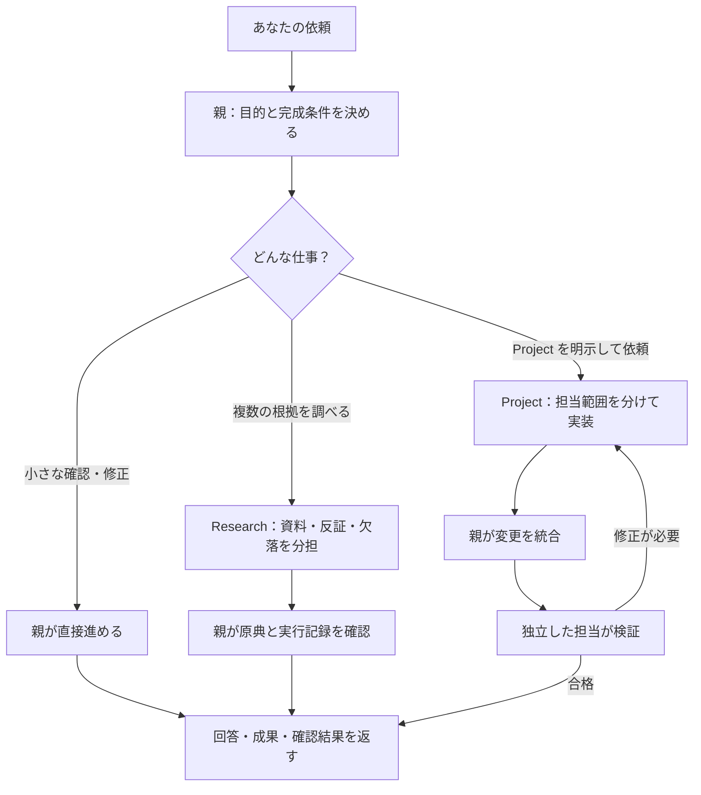
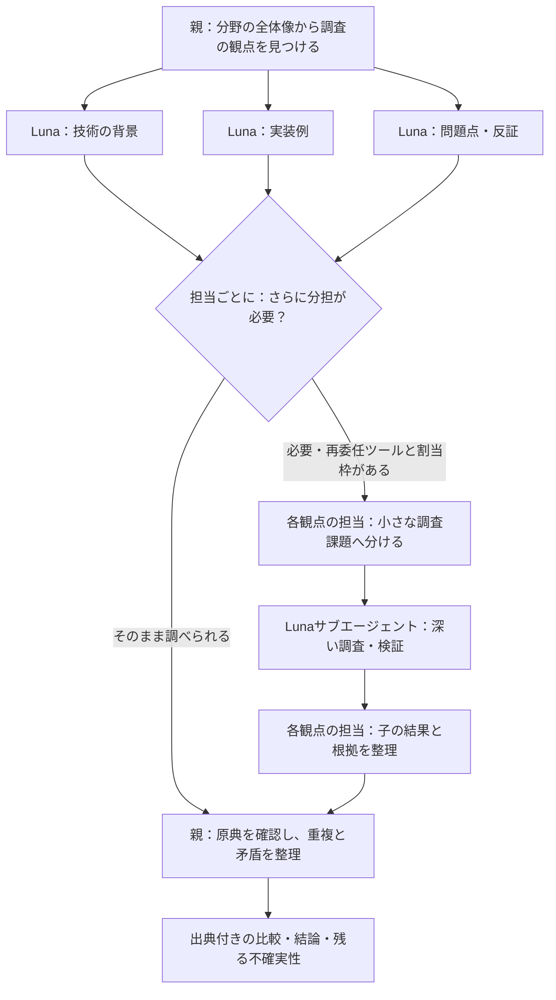
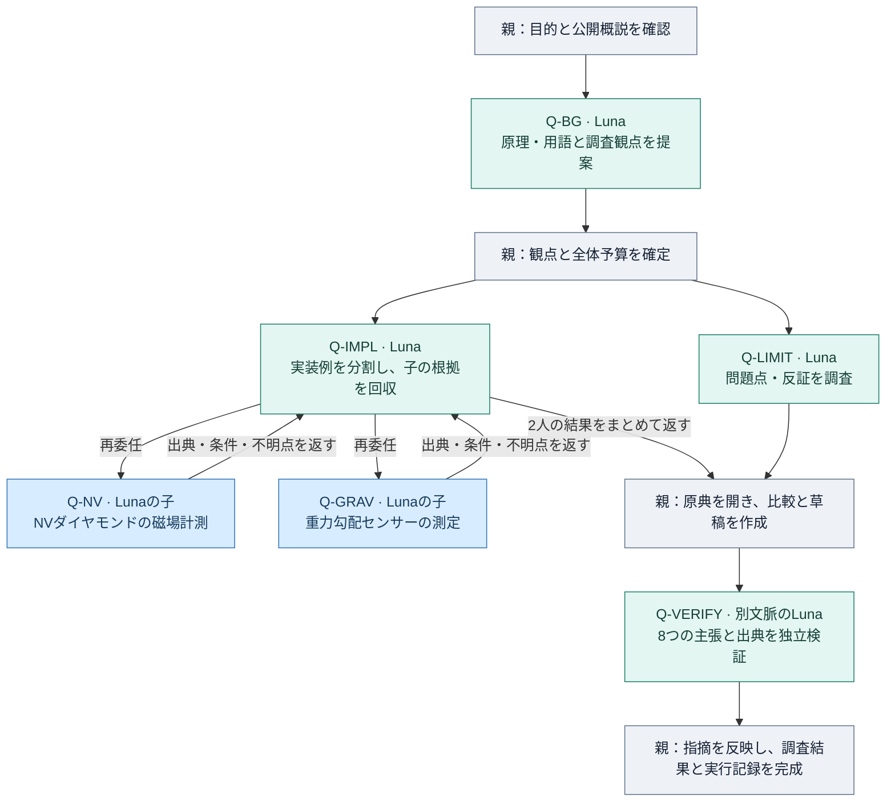
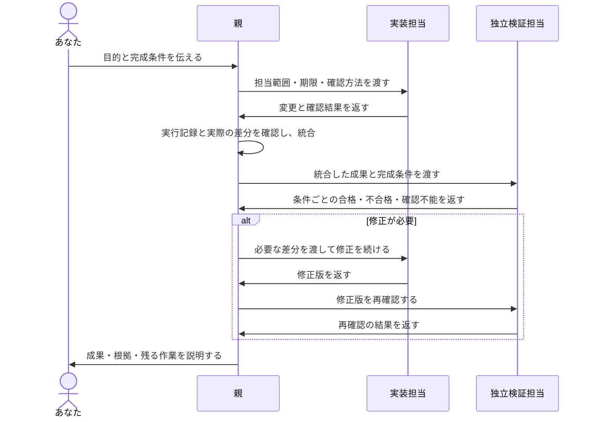

# Luna Research & Project Skills

[](https://github.com/dj-thank/luna-research-skills/actions/workflows/validate.yml)
[](https://github.com/dj-thank/luna-research-skills/releases)

Codexで観点ごとにエージェントを分けて調査する「Luna Research & Project Skills」です。

何かを調べるとき、特に自分が知らない分野では、何を調べればよいか自体が分からないことがあります。そこで、技術の背景、実装例、問題点などの観点で担当を分け、必要に応じて各担当がさらにサブエージェントを呼び、深く調査・検証できるようにしました。

**GPT-6 Lunaを並列に。調査の視野を広げ、出典付きの結論へ。**

最初に分野の全体像を調べ、調査に必要な観点を見つけます。担当が集めた根拠は、各観点の担当を通じて親の Codex に戻り、親が原典を確かめて結論へまとめます。

標準の担当モデルは **GPT-6 Luna / low** です。公式資料・代替案・反証・未確認の点を別々の担当が調べ、親の Codex が原典を確かめて統合します。親にはユーザーが選んだモデルを使います。Sol の担当は、明示して選んだ場合に利用できます。

この README は **main ブランチの仕様**を説明します。Release の ZIP は、それぞれの公開時点を固定した版です。最新の仕様を試す場合は、下の手順で main を取得してください。[変更履歴](CHANGELOG.md)

実際の例を見るなら、[量子センサーの調査結果](docs/quantum-sensors-research-2026-10-14.md)と[6体のLunaによる分担・再委任・検証](docs/luna-research-e2e-2026-10-14.md)を読めます。実際の流れは下の調査例にも図で掲載しています。

## まず、この3つだけ

- **調べたい** → `$run-diverse-luna-research`
- **複数の部分を実装し、検証まで進めたい** → `$run-diverse-luna-project` を明示して依頼
- **小さな確認・一ファイルの修正** → 親が直接進める

スキルは、Codex が必要なときに読む作業手順です。「親」は依頼を受けた Codex、「担当」は親が起動した別のエージェントを指します。担当を増やすこと自体は目的にせず、必要な仕事だけを分けます。



## なぜ Luna で並行調査するのか

一つの担当に全部を調べさせる代わりに、**異なる観点を同時に進められる**ことが中心の価値です。低単価の Luna に範囲を絞った調査を分担し、親には結論と出典だけを戻します。親は重複した情報を整理し、反証も含めて判断します。



図は分け方の例です。観点は分野に合わせて選びます。再委任が必要な担当には、同じ全体予算の中から子の枠と深さを割り当てます。再委任ツールを使えない担当の残作業は、親が引き取ります。担当数は目的と実行環境に合わせ、起動を最大3件ずつに分けます。同じ記事を複数の担当が見ても、独立した裏付けが増えたとは数えません。

### 利用量の余裕を説明できる根拠

2026年10月14日に確認した公式の **追加クレジット・Standard速度の単価**は次のとおりです。単位は100万トークン当たりのクレジットです。

| モデル | 入力 | キャッシュ入力 | 出力 |
|---|---:|---:|---:|
| GPT-6 Luna | 2.5 | 0.25 | 12.5 |
| GPT-6.1 Sol | 50 | 2.5 | 250 |
| GPT-6 Astra | 250 | 25 | 1,250 |

同じ非キャッシュ入力・出力トークン量なら、Luna の単価は Sol の **20分の1**、Astra の **100分の1**です。この差が、観点を増やす設計を選ぶ理由になります。[公式料金表](https://learn.chatgpt.com/docs/pricing#token-rates)

プランに含まれる利用枠は別の条件で計算され、トークン量・推論強度・速度設定・ツール利用でも変わります。トークン消費はあり、並列化しただけで利用量がゼロにはなりません。実際の総消費には親の統合も含めて確認します。Plus / Standard Business の Luna の目安は5時間で350〜3,000ローカルメッセージですが、固定の保証値ではありません。[公式の利用枠](https://learn.chatgpt.com/docs/pricing#what-are-the-usage-limits-for-my-plan)

### Sol を明示して使う場合

依頼に「担当も GPT-6.1 Sol / low で」と書きます。親は起動時にそのモデルを指定し、照合時にも `--specialist-model gpt-6.1-sol` を付けます。Luna の記録を Sol として受理することや、Sol へ自動で切り替えることはありません。[モデル選択の手順](.agents/skills/run-diverse-luna-research/references/model-policy.md)

## できること

| | Research：調べる | Project：作る |
|---|---|---|
| 向いている依頼 | 技術や文献の調査、候補の比較、事実確認、反証 | 複数の機能の実装、監査と修正、移行、成果物の制作 |
| 担当が行うこと | 一次資料・実測・反例・不足する証拠を集める | 割り当てられたファイルや worktree で変更を作る |
| 親が確認すること | 原典、条件の違い、情報の重複、矛盾と不明点 | 実際の差分、統合結果、テスト、独立検証 |
| 受け取るもの | 出典付きの結論、比較表、判断に残る不確実性 | 変更した成果、検証結果、残る作業 |

Research の担当は証拠を返します。調査と実装を組み合わせる場合も、実装と最終統合は依頼を受けた親の作業として進めます。Project の分業を使う場合は、スキル名または Luna による分担実装を明示してください。

## ステップ1：利用できる環境を確認する

必要なものは次のとおりです。

1. ローカルスキルとサブエージェントを利用できる Codex 環境
2. GPT-6 Luna を使えるアカウント・ワークスペース
3. **Python 3.11 以上**（設定・実行記録のチェッカーに使用）
4. Git（リポジトリを取得する場合）
5. Web 調査では、検索・ページ取得ツールとその利用権限

Python のバージョンを確認します。以下では `python` を使います。環境での実行名が異なる場合は、Python 3.11 以上を指すコマンドへ置き換えてください。

```sh
python --version
```

スキルを導入しても、利用できるモデル・ツール・権限が増えるわけではありません。必要な分業経路を使えない場合は、その理由を示して、親が進められる作業を続けます。

## ステップ2：取得し、Codex で開く

```sh
git clone https://github.com/dj-thank/luna-research-skills.git
cd luna-research-skills
```

**このフォルダーを Codex のプロジェクトとして開き、新しいチャットを始めます。** `.agents/skills` にある2つのスキルを、このリポジトリ内で使えます。

ユーザースコープにも同名スキルを導入済みの場合は、どちらを使うか確認します。内容が違うコピーを自動で混ぜず、現在選ばれたスキルの場所を記録してください。[導入と更新の詳細](docs/INSTALLATION.md)

```text
luna-research-skills/
├─ .agents/skills/
│  ├─ run-diverse-luna-research/   調査の手順
│  └─ run-diverse-luna-project/    実装・検証の手順
├─ .codex/agents/                 任意のカスタム役割
├─ tools/                        導入・検証ツール
└─ docs/                         詳しい使い方と評価記録
```

標準の分担経路は、組み込みの `default` または `worker` に、モデル・推論強度・独立した文脈を明示する方法です。`.codex/agents` のカスタム役割は任意であり、役割名を指定しただけでは実際のモデルや利用可能なツールを確定できません。[公式のスキル読み込み仕様](https://learn.chatgpt.com/docs/build-skills#where-codex-loads-local-skills)

### ほかのプロジェクトでも使いたい場合

取得したフォルダーで、まず導入先と変更予定を確認します。

```sh
python tools/install_luna_skills.py
```

内容を確認した後、導入と照合を行います。macOS・Linux・Windows で同じ操作です。

```sh
python tools/install_luna_skills.py --apply
python tools/install_luna_skills.py --verify
```

導入先は `$HOME/.agents/skills` です。導入器は親モデルやグローバル設定を変更しません。**すでに同名スキルがある場合は上書きせず停止します。** 更新前にローカル変更と配置先を確認してください。Windows の移行、Cloud、plugin ZIP の手順は[導入と更新の詳細](docs/INSTALLATION.md)にあります。

### すでに導入済みの場合の更新

1. 取得済みリポジトリで `git status --short` を実行し、ローカル変更の有無を確認します。変更があれば先に保全し、自動で消さないでください。
2. 変更のない取得元を main の最新版へ更新します。

   ```sh
   git switch main
   git pull --ff-only
   ```

3. リポジトリ内で使う場合は、このフォルダーを Codex で開き直します。ユーザースコープで使う場合は、導入先との比較とバックアップを行い、[既存スキルの更新手順](docs/INSTALLATION.md#既存スキルを更新する)に従って更新します。導入器は既存コピーを上書きしません。
4. 新しいチャットで、次の準備チェックから再確認します。古い Release ZIP は `git pull` では更新できません。新しい source を別のフォルダーへ取得して比較してください。

## ステップ3：準備状態を確認する

リポジトリのルートで実行します。

```sh
python .agents/skills/run-diverse-luna-research/scripts/check_setup.py --agent-role default --allow-generic-worker
```

`READY` は、保存設定などの準備確認が通ったという意味です。**実際の子エージェントが動いた証明は、次のステップで取得します。**

このスキルの設定チェックは、分業が有効で、子の同時上限が **2〜6** に設定されていることを求めます。設定を調整する必要がある場合の例は次のとおりです。使用する Codex 設定に既存の `[agents]` があれば、その節を確認し、重複して追加しないでください。

```toml
[agents]
enabled = true
max_concurrent_threads_per_session = 6
```

これは本スキルの分業条件です。Codex 自体の既定値とは区別してください。インストーラーはこの設定を自動適用しません。モデルと推論強度は各起動で明示するため、親のモデル設定を変更する必要はありません。[公式サブエージェント設定](https://learn.chatgpt.com/docs/agent-configuration/subagents#global-settings)

Windows でコマンドが失敗する、設定と CLI 表示が食い違う、といった場合は[環境の確認手順](.agents/skills/run-diverse-luna-research/references/environment-check.md)を使います。別の実行アカウント・Python・サンドボックスの表示を、現在のチャットの動作と混同しないようにします。V2 を必要とする実行にだけ `--require-v2` を追加します。

## ステップ4：最初の依頼を送る

### 調査を頼む

```text
$run-diverse-luna-research
量子センサーについて、まだ何を調べればよいか分かりません。
まず全体像と重要な用語を整理し、背景・実装例・問題点などの観点を選んでください。
観点ごとに担当を分け、必要なら担当がさらにサブエージェントを呼んで調査・検証し、
出典付きの比較と、まだ分からない点をまとめてください。
```

「何を決めたいか」を添えると、調べる範囲を絞れます。担当は別の論点を受け持ち、親が原典を確認します。同じ発表を転載したページを、独立した複数の裏付けに数えません。

### この調査例を実際に試した結果

上の量子センサーの依頼を、公開資料を使って実行しました。**GPT-6 Luna / lowを延べ6体**起動し、実装担当から2体への再委任、根拠の回収、別文脈での独立検証まで完了しました。

| 見たいもの | 内容 |
|---|---|
| [量子センサーの調査結果を読む](docs/quantum-sensors-research-2026-10-14.md) | 全体像、用語、NV磁場計測と重力勾配の実装例、比較の条件、未確認の点 |
| [6体の実行の流れを読む](docs/luna-research-e2e-2026-10-14.md) | 担当ごとの仕事、再委任と回収、検証結果、実行中の修正、確認範囲 |
| [公開用の実行記録JSON](docs/luna-research-e2e-2026-10-14.json) | 親子関係、実測した担当モデル、8つの主張の判定、出典と取得範囲 |



図の親の工程は同じCodexです。Q-IMPLは子への依頼と回収を行った同じ担当で、Lunaの担当は合計6体です。**同時最大3体、確認した深さは2**でした。親が7資料を確認し、独立検証では8つの主張のうち5件がPASS、3件がQUALIFYとなり、親が必要な限定表現を反映しました。

これは実際のCodexの分業手順と文献調査の確認です。センサー実験の実機再現や料金・利用枠の削減率は確認していません。

### 実装を頼む

```text
$run-diverse-luna-project
このWebサービスにデータのエクスポート機能を追加してください。
APIと画面を分担し、既存の変更を保全して、
実装、統合、独立検証まで進めてください。
完成条件は「画面からCSVをダウンロードでき、内容を検証できる」です。
```

「作るもの」と「どうなれば完成か」を伝えます。担当範囲が重なる変更や、実機・認証済みサービスの操作は、一つの担当にまとめます。修正の続きには同じ担当の `followup_task` を使い、独立した最終確認には別の担当を使います。



## ステップ5：結果を確かめる

回答や成果と一緒に、次の情報を確認します。

| 確認するもの | 分かること |
|---|---|
| 出典・実際の変更 | 結論や成果を支える中身 |
| 子の完了した turn の実行記録 | 実際のモデル・推論強度・完了状態 |
| 親の起動記録 | どの依頼から、どの経路で子を起動したか |
| 条件ごとの検証結果 | 何が合格し、何が未確認か |

親が正確な子 UUID・完了 turn UUID・起動記録を特定した後、例えば次のコマンドで照合します。

```sh
python .agents/skills/run-diverse-luna-research/scripts/check_setup.py --agent-role default --allow-generic-worker --runtime-thread <child-uuid> --runtime-turn <completed-turn-uuid> --parent-rollout <actual-root.jsonl> --require-spawn-provenance
```

`<...>` は実測値へ置き換える欄です。Codex に値の特定と照合を頼めます。子は自分の完了後にしか得られない記録を作業開始前に用意せず、親が完了後に確認します。

この起動記録の照合は**最初の子 turn**に対するものです。後続の `followup_task` は継続用の記録として扱い、最初の起動記録をそのまま後続 turn の証明には使いません。完全な Research / Project 実行では、担当・結果・根拠を記録する**台帳**も照合します。詳しくは各スキルの実行契約を参照してください。

### 「合格」の範囲も確認する

| 記録 | 確認した範囲 |
|---|---|
| `LOCAL_PASS` | ローカルの成果・テスト |
| `DEVICE_PASS` | 実機での動作 |
| `PROVIDER_PASS` | 外部サービスでの動作 |
| `PUBLIC_PASS` | 公開された結果の読み取り確認 |
| `HUMAN_GO` | 必要な人間の承認 |

必要な段階は依頼によって異なります。ローカルのテストだけで、実機や公開環境も確認済みとは扱いません。送信・公開・購入・削除・デプロイは、依頼された権限の範囲で行います。[権限とデータの扱い](SECURITY.md)

## 担当を増やしすぎない仕組み

標準は、親から **1〜2人の担当へ直接分ける構成**です。次の予算を、最初から最後まで共有します。

| 記号 | 意味 | このスキルの方針 |
|---|---|---|
| `N` | 起動・継続・失敗・再試行を含む総試行数 | 既定6、最大12 |
| `C` | 同時に開く子の上限 | 最大6、実行環境の上限以下 |
| `W` | 一度に開始する数 | 通常1〜2、最大3 |
| `V` | 必要な独立検証に残す枠 | `max(1, ceil(0.15 × N))` |

起動前に `check_dispatch_budget.py` が実際の呼び出し記録を数えます。子・再試行・継続ごとに新しい予算は作りません。枠を使い切った後も、必要な残作業は親が進めます。起動数を抑える方針だけで、速度や消費枠の削減率を保証するものではありません。

大きな仕事では調整役がさらに分担できますが、その役割で再委任ツールを使えることと、同じ予算内の割当が必要です。まず直接分担から始め、階層が必要な場合だけ[再帰委任の契約](.agents/skills/run-diverse-luna-research/references/recursive-delegation.md)を使います。Astra 調整役を含む構成は[明示的なモデル構成](.agents/skills/run-diverse-luna-research/references/model-policy.md)に従います。

## どこまで確認したか

現在の Luna 経路と、Sol を明示して選ぶ経路は、設定・実行記録・親の起動記録を照合する checker で区別します。公開版の回帰テストと CI は、モデルの取り違え・明示選択なしの Sol 受理・同時上限超過を検査します。

[量子センサー例の6体による実行記録](docs/luna-research-e2e-2026-10-14.md)に、実際の調査から独立検証とまとめまでの確認を記録しています。[Luna 方針と確認範囲](docs/luna-first-2026-10-14.md)には、モデル方針の更新時の実測を記録します。[未知分野の手順と再委任の実行確認](docs/unknown-field-research-2026-10-14.md)には、Luna の担当から Luna の子を呼び、根拠を戻した範囲を記録しています。[前の Sol 経路の確認](docs/compatibility-2026-10-14.md)と[2026年9月5日の評価](docs/research-evaluation-2026-09-05.md)は、その時点のモデルの記録として保持します。過去の成功を、別のモデルの実行証明に使いません。

## 困ったとき

| 状況 | 確認すること |
|---|---|
| スキルが表示されない | 正しいプロジェクトを開いているか、新しいチャットで確認したか |
| `destination already exists` | 既存スキルの保護。削除して再試行せず、差分と所有者を確認 |
| モデルを起動できない | 現在のモデル一覧とアカウント権限。別モデルへ自動で切り替えない |
| 準備チェックと実行が食い違う | 保存設定・別 CLI・現在のチャットのツールと実行記録を区別 |
| 子がさらに分担できない | その子の実際のツールを確認し、親からの直接分担を検討 |
| `yaml` の形式検証が失敗する | 検証用 Python と PyYAML の実体。通常実行とサンドボックスの違い |

Python の導入器・実行記録チェッカー・回帰テストは標準ライブラリを使います。開発者向けの Skill Creator 形式検証には、別途 PyYAML が必要です。[環境の確認手順](.agents/skills/run-diverse-luna-research/references/environment-check.md)

## 詳しい資料

| 資料 | 読む場面 |
|---|---|
| [Research のスキル](.agents/skills/run-diverse-luna-research/SKILL.md) / [Project のスキル](.agents/skills/run-diverse-luna-project/SKILL.md) | 実際の作業手順を確認したい |
| [量子センサーの調査結果](docs/quantum-sensors-research-2026-10-14.md) | 出典付きの実際の調査例を読みたい |
| [6体の分担・再委任・検証](docs/luna-research-e2e-2026-10-14.md) | 調査がどの順番で動き、どこまで確認したか知りたい |
| [導入と更新](docs/INSTALLATION.md) | 別プロジェクト・Windows 移行・Cloud・plugin で使いたい |
| [今回の確認範囲](docs/compatibility-2026-10-14.md) | 実測と未検証の境界を確認したい |
| [開発・検証手順](CONTRIBUTING.md) | コードやスキルを変更したい |
| [変更履歴](CHANGELOG.md) | main と Release の違いを確認したい |
| [公式サブエージェント仕様](https://learn.chatgpt.com/docs/agent-configuration/subagents) | Codex 側の設定・モデル解決・権限を確認したい |

コミュニティ製のスキル集です。ライセンスは [MIT](LICENSE) です。
