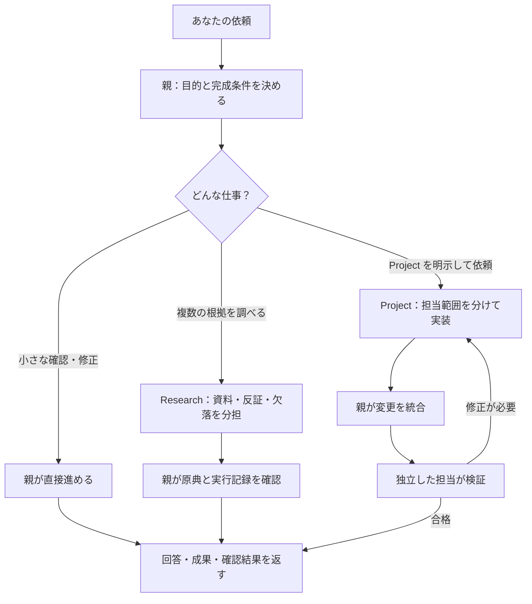
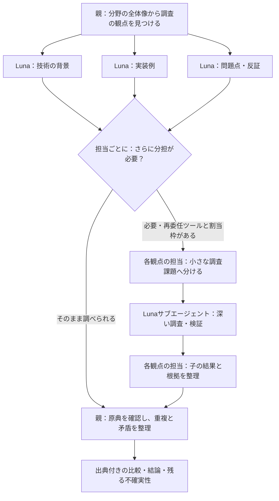
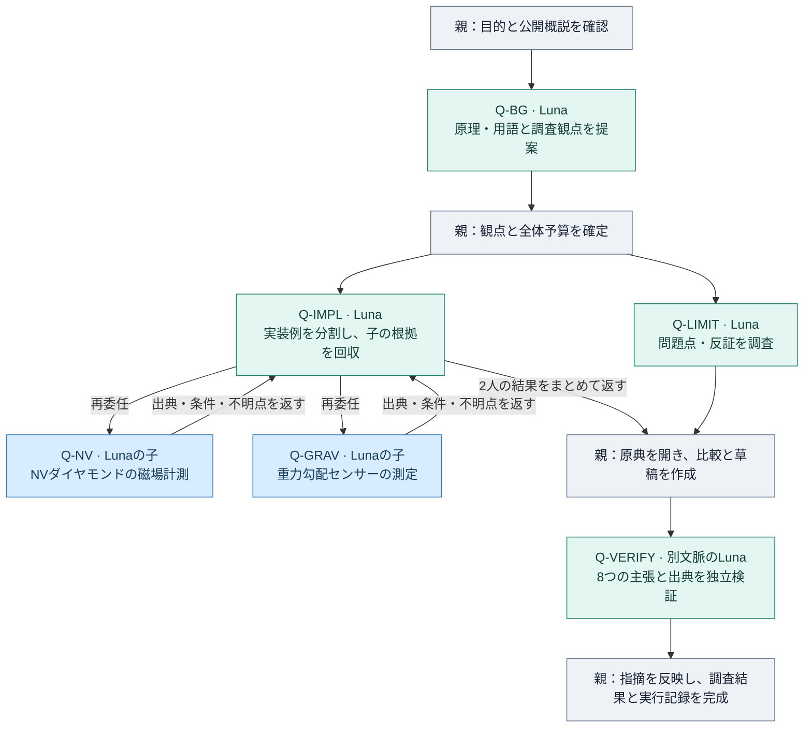
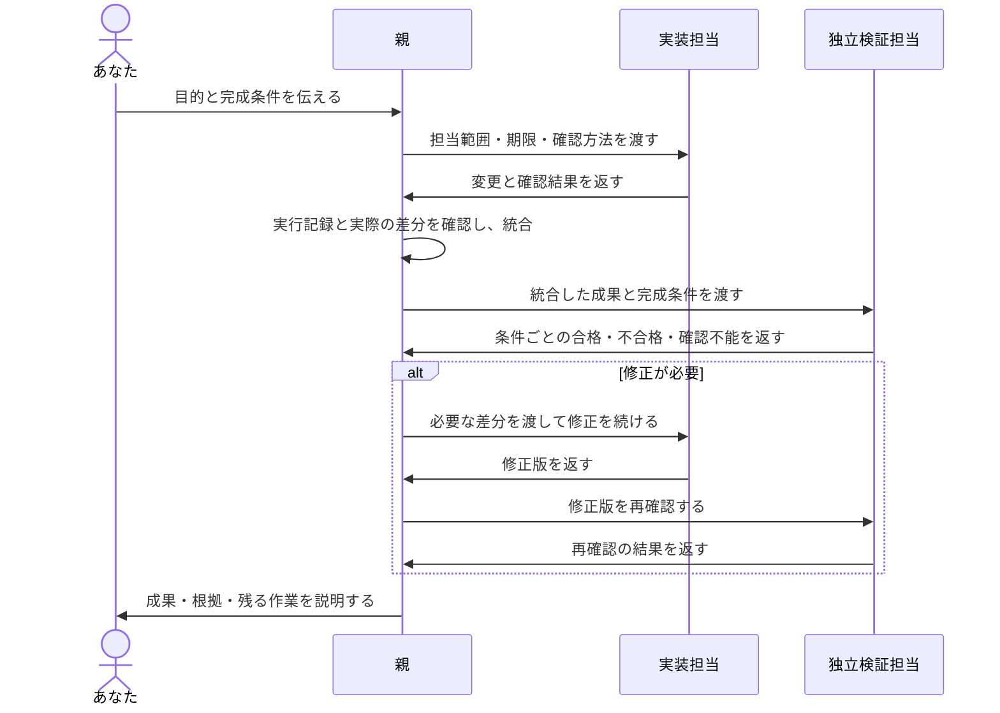

# Luna Research & Project Skills

[English](README.en.md) | **日本語**

[](https://github.com/dj-thank/luna-research-skills/actions/workflows/validate.yml)
[](https://github.com/dj-thank/luna-research-skills/releases)

**Codexで調査・実装を分担し、根拠と検証結果を確かめて一つの成果へ統合するスキル集です。**

Researchは一次資料・代替案・反証を調べ、Projectは担当範囲を分けて実装・統合・検証を進めます。依頼を受けた親のCodexが、完成条件、分業予算、成果の受入を管理します。小さな作業は親が直接進めます。

公開スキルの標準担当は **GPT-6 Luna / low**、明示選択では **GPT-6.1 Sol / low** を使えます。親はユーザーが選んだモデルを維持します。スキルは手順と検証ツールを提供し、独立した常駐サービスとして動くものではありません。

この README は **main ブランチの仕様**を説明します。Release の ZIP は、それぞれの公開時点を固定した版です。最新の仕様を試す場合は、下の手順で main を取得してください。[変更履歴](CHANGELOG.md)

実際の例を見るなら、[量子センサーの調査結果](docs/quantum-sensors-research-2026-10-14.md)と[6体のLunaによる分担・再委任・検証](docs/luna-research-e2e-2026-10-14.md)を読めます。実際の流れは下の調査例にも図で掲載しています。

## すぐに使う

GitとPython 3.11以上、および利用する担当モデルとサブエージェントを使えるCodex環境を用意します。

```sh
git clone https://github.com/dj-thank/luna-research-skills.git
cd luna-research-skills
```

このフォルダーをCodexで開き、`$run-diverse-luna-research` または `$run-diverse-luna-project` と、目的・完成条件を伝えます。リポジトリ内で試すだけなら、ユーザースコープへのコピーは不要です。

| OS | Pythonの確認 | 準備チェック |
|---|---|---|
| Windows（PowerShell） | `py -3 --version` | `py -3 .agents/skills/run-diverse-luna-research/scripts/check_setup.py --agent-role default --allow-generic-worker` |
| macOS / Linux | `python3 --version` | `python3 .agents/skills/run-diverse-luna-research/scripts/check_setup.py --agent-role default --allow-generic-worker` |

以下の例の `python` は、その環境のPython 3.11以上を指すコマンドへ置き換えます。準備チェックが通らない場合は[ステップ3](#ステップ3準備状態を確認する)へ進みます。`READY` は準備状態であり、子が実際に動いた証明ではありません。

| 目的 | 入口 |
|---|---|
| 最初の依頼を書く | [調査・実装の依頼例](#ステップ4最初の依頼を送る) |
| 他のプロジェクトへ導入・更新する | [OS共通の導入とWindows移行](docs/INSTALLATION.md) |
| 担当選択・依存待ち・再試行を確認する | [スウォームの運用とPlanner 1.2](.agents/skills/run-diverse-luna-project/references/swarm-coordination.md) |
| エージェントを起動せず評価ツールを試す | [比較を再現する](#比較を自分で再現する) |
| 変更に参加する | [開発・検証手順](CONTRIBUTING.md) |

## まず、この3つだけ

- **調べたい** → `$run-diverse-luna-research`
- **複数の部分を実装し、検証まで進めたい** → `$run-diverse-luna-project` を明示して依頼
- **小さな確認・一ファイルの修正** → 親が直接進める

スキルは、Codex が必要なときに読む作業手順です。「親」は依頼を受けた Codex、「担当」は親が起動した別のエージェントを指します。担当を増やすこと自体は目的にせず、必要な仕事だけを分けます。



## なぜ Luna で並行調査するのか

中心の価値は、**異なる観点を同時に進められる**ことです。担当に範囲を絞った調査を分担し、親には結論と出典を戻します。親は重複した情報を整理し、反証も含めて判断します。



図は分け方の例です。観点は分野に合わせて選びます。再委任が必要な担当には、同じ全体予算の中から子の枠と深さを割り当てます。再委任ツールを使えない担当の残作業は、親が引き取ります。担当数は目的と実行環境に合わせ、起動を最大3件ずつに分けます。同じ記事を複数の担当が見ても、独立した裏付けが増えたとは数えません。

### 利用量と費用を確認する

利用量は、担当だけでなく親の調査・統合、再試行、検証も含めて比較します。このリポジトリの合成ベンチマークから、実際の速度・費用・利用枠の削減率は判断できません。現在の条件は[公式料金表](https://learn.chatgpt.com/docs/pricing#token-rates)と[プランの利用枠](https://learn.chatgpt.com/docs/pricing#what-are-the-usage-limits-for-my-plan)で確認してください。

### Sol を明示して使う場合

依頼に「担当も GPT-6.1 Sol / low で」と書きます。親は起動時にそのモデルを指定し、照合時にも `--specialist-model gpt-6.1-sol` を付けます。Luna の記録を Sol として受理することや、Sol へ自動で切り替えることはありません。[モデル選択の手順](.agents/skills/run-diverse-luna-research/references/model-policy.md)

## できること

| | Research：調べる | Project：作る |
|---|---|---|
| 向いている依頼 | 技術や文献の調査、候補の比較、事実確認、反証 | 複数の機能の実装、監査と修正、移行、成果物の制作 |
| 担当が行うこと | 一次資料・実測・反例・不足する証拠を集める | 割り当てられたファイルや worktree で変更を作る |
| 親が確認すること | 原典、条件の違い、情報の重複、矛盾と不明点 | 実際の差分、統合結果、テスト、独立検証 |
| 受け取るもの | 出典付きの結論、比較表、判断に残る不確実性 | 変更した成果、検証結果、残る作業 |

Research の担当は証拠を返します。調査と実装を組み合わせる場合も、実装と最終統合は依頼を受けた親の作業として進めます。Project の分業を使う場合は、スキル名または Luna による分担実装を明示してください。

## ステップ1：利用できる環境を確認する

必要なものは次のとおりです。

1. ローカルスキルとサブエージェントを利用できる Codex 環境
2. GPT-6 Luna、または明示選択するGPT-6.1 Solを使えるアカウント・ワークスペース
3. **Python 3.11 以上**（設定・実行記録のチェッカーに使用）
4. Git（リポジトリを取得する場合）
5. Web 調査では、検索・ページ取得ツールとその利用権限

Python のバージョンを確認します。以下では `python` を使います。環境での実行名が異なる場合は、Python 3.11 以上を指すコマンドへ置き換えてください。

```sh
python --version
```

スキルを導入しても、利用できるモデル・ツール・権限が増えるわけではありません。必要な分業経路を使えない場合は、その理由を示して、親が進められる作業を続けます。

## ステップ2：取得し、Codex で開く

```sh
git clone https://github.com/dj-thank/luna-research-skills.git
cd luna-research-skills
```

**このフォルダーを Codex のプロジェクトとして開き、新しいチャットを始めます。** `.agents/skills` にある2つのスキルを、このリポジトリ内で使えます。

ユーザースコープにも同名スキルを導入済みの場合は、どちらを使うか確認します。内容が違うコピーを自動で混ぜず、現在選ばれたスキルの場所を記録してください。[導入と更新の詳細](docs/INSTALLATION.md)

```text
luna-research-skills/
├─ .agents/skills/
│  ├─ run-diverse-luna-research/   調査の手順
│  └─ run-diverse-luna-project/    実装・検証の手順
├─ .codex/agents/                 任意のカスタム役割
├─ tools/                        導入・検証ツール
└─ docs/                         詳しい使い方と評価記録
```

標準の分担経路は、組み込みの `default` または `worker` に、モデル・推論強度・独立した文脈を明示する方法です。`.codex/agents` のカスタム役割は任意であり、役割名を指定しただけでは実際のモデルや利用可能なツールを確定できません。[公式のスキル読み込み仕様](https://learn.chatgpt.com/docs/build-skills#where-codex-loads-local-skills)

### ほかのプロジェクトでも使いたい場合

取得したフォルダーで、まず導入先と変更予定を確認します。

```sh
python tools/install_luna_skills.py
```

内容を確認した後、導入と照合を行います。macOS・Linux・Windows で同じ操作です。

```sh
python tools/install_luna_skills.py --apply
python tools/install_luna_skills.py --verify
```

導入先は `$HOME/.agents/skills` です。導入器は親モデルやグローバル設定を変更しません。**すでに同名スキルがある場合は上書きせず停止します。** 更新前にローカル変更と配置先を確認してください。Windows の移行、Cloud、plugin ZIP の手順は[導入と更新の詳細](docs/INSTALLATION.md)にあります。

### すでに導入済みの場合の更新

1. 取得済みリポジトリで `git status --short` を実行し、ローカル変更の有無を確認します。変更があれば先に保全し、自動で消さないでください。
2. 変更のない取得元を main の最新版へ更新します。

   ```sh
   git switch main
   git pull --ff-only
   ```

3. リポジトリ内で使う場合は、このフォルダーを Codex で開き直します。ユーザースコープで使う場合は、導入先との比較とバックアップを行い、[既存スキルの更新手順](docs/INSTALLATION.md#既存スキルを更新する)に従って更新します。導入器は既存コピーを上書きしません。
4. 新しいチャットで、次の準備チェックから再確認します。古い Release ZIP は `git pull` では更新できません。新しい source を別のフォルダーへ取得して比較してください。

## ステップ3：準備状態を確認する

リポジトリのルートで実行します。

```sh
python .agents/skills/run-diverse-luna-research/scripts/check_setup.py --agent-role default --allow-generic-worker
```

`READY` は、保存設定などの準備確認が通ったという意味です。**実際の子エージェントが動いた証明は、次のステップで取得します。**

このスキルの設定チェックは、分業が有効で、子の同時上限が **2〜6** に設定されていることを求めます。設定を調整する必要がある場合の例は次のとおりです。使用する Codex 設定に既存の `[agents]` があれば、その節を確認し、重複して追加しないでください。

```toml
[agents]
enabled = true
max_concurrent_threads_per_session = 6
```

これは本スキルの分業条件です。Codex 自体の既定値とは区別してください。インストーラーはこの設定を自動適用しません。モデルと推論強度は各起動で明示するため、親のモデル設定を変更する必要はありません。[公式サブエージェント設定](https://learn.chatgpt.com/docs/agent-configuration/subagents#global-settings)

Windows でコマンドが失敗する、設定と CLI 表示が食い違う、といった場合は[環境の確認手順](.agents/skills/run-diverse-luna-research/references/environment-check.md)を使います。別の実行アカウント・Python・サンドボックスの表示を、現在のチャットの動作と混同しないようにします。V2 を必要とする実行にだけ `--require-v2` を追加します。

## ステップ4：最初の依頼を送る

### 調査を頼む

最初は、用途と比較対象を絞った依頼から始められます。

```text
$run-diverse-luna-research
個人用の小さなアプリで、SQLiteとPostgreSQLのどちらを使うか判断したいです。
公開された公式資料を使い、調査日の安定版を対象に、導入の手間・バックアップ・
同時更新の制約を比較してください。比較表、出典、未確認の点をまとめてください。
分担が有効な観点だけを分け、今回は再帰的な委任は不要です。
```

親だけの短い確認で答えられる場合は、そのまま回答します。未知の分野を広く調べたいときは、次のように依頼できます。

```text
$run-diverse-luna-research
量子センサーについて、まだ何を調べればよいか分かりません。
まず全体像と重要な用語を整理し、背景・実装例・問題点などの観点を選んでください。
観点ごとに担当を分け、必要なら担当がさらにサブエージェントを呼んで調査・検証し、
出典付きの比較と、まだ分からない点をまとめてください。
```

「何を決めたいか」を添えると、調べる範囲を絞れます。担当は別の論点を受け持ち、親が原典を確認します。同じ発表を転載したページを、独立した複数の裏付けに数えません。

### この調査例を実際に試した結果

上の量子センサーの依頼を、公開資料を使って実行しました。**GPT-6 Luna / lowを延べ6体**起動し、実装担当から2体への再委任、根拠の回収、別文脈での独立検証まで完了しました。

| 見たいもの | 内容 |
|---|---|
| [量子センサーの調査結果を読む](docs/quantum-sensors-research-2026-10-14.md) | 全体像、用語、NV磁場計測と重力勾配の実装例、比較の条件、未確認の点 |
| [6体の実行の流れを読む](docs/luna-research-e2e-2026-10-14.md) | 担当ごとの仕事、再委任と回収、検証結果、実行中の修正、確認範囲 |
| [公開用の実行記録JSON](docs/luna-research-e2e-2026-10-14.json) | 親子関係、実測した担当モデル、8つの主張の判定、出典と取得範囲 |



図の親の工程は同じCodexです。Q-IMPLは子への依頼と回収を行った同じ担当で、Lunaの担当は合計6体です。**同時最大3体、確認した深さは2**でした。親が7資料を確認し、独立検証では8つの主張のうち5件がPASS、3件がQUALIFYとなり、親が必要な限定表現を反映しました。

これは実際のCodexの分業手順と文献調査の確認です。センサー実験の実機再現や料金・利用枠の削減率は確認していません。

### 実装を頼む

```text
$run-diverse-luna-project
このWebサービスにデータのエクスポート機能を追加してください。
APIと画面を分担し、既存の変更を保全して、
実装、統合、独立検証まで進めてください。
完成条件は「画面からCSVをダウンロードでき、内容を検証できる」です。
```

「作るもの」と「どうなれば完成か」を伝えます。担当範囲が重なる変更や、実機・認証済みサービスの操作は、一つの担当にまとめます。修正の続きには同じ担当の `followup_task` を使い、独立した最終確認には別の担当を使います。



### スウォームの待ち時間と衝突を減らす

API担当と説明書担当を並行して動かし、APIの成果を親が受理したら、その版を入力に画面担当を開始できます。説明書担当の完了まで待つ必要はありません。最後は親が統合した同じ版を、独立した担当が検証します。

依存する成果の版、編集範囲、共有機器の担当を明確にし、タイムアウト時は前の担当が書き込めなくなったことを確認してから引き継ぎます。台帳のチェックは所有権の衝突や再試行の順序を検査しますが、実プロセスの停止や性能向上を証明するものではありません。[具体的なスウォーム運用例](.agents/skills/run-diverse-luna-project/references/swarm-coordination.md)に、待たずに進める条件と古い成果を採用しない手順をまとめています。

付属の `plan_swarm.py` は、flatなProject v2台帳から次の実行候補と待ち理由をJSONで返します。レビュー待ち・依存待ち・担当衝突・枠不足・統合待ちを確認でき、台帳の変更やエージェントの起動は行いません。[使い方](.agents/skills/run-diverse-luna-project/references/swarm-coordination.md#inspect-the-next-batch)

Planner 1.2は、古い失敗した試行への依存が残るとき、受理済み再試行を `dependency_replacement_hints` に示します。親が成果物と入力条件を確認して依存先を更新します。候補が見つかっても期限・容量・権限などの制約は残り、自動で別の成果へ切り替えません。

実際の担当選択と検証結果を台帳へ戻しながら改善できます。`python tools/benchmark_swarm.py` で事前に定義した正解と比較し、通信方式の実験と実エージェントでの修復確認は[スウォームの評価・改善手順](docs/swarm-experiments.md)に沿って記録します。Solを明示選択した実行では、プランナーにも `--specialist-model gpt-6.1-sol` を指定します。

### 調査した改善案を実装へつなぐ

```text
このリポジトリを、使う人・調査の質・保守する人の観点で調べてください。
改善候補には根拠、対象ファイル、確かめ方、変更しない場合の理由も添えてください。
効果と根拠のあるものを選び、既存の挙動を保ちながら実装・検証してください。
```

調査担当は根拠と提案を返し、親が採否・実装・確認を引き受けます。[改善への引継ぎ例](.agents/skills/run-diverse-luna-research/references/workflow.md#handoff-to-authorized-implementation)のように、根拠と確認方法を結び付けます。Projectによる実装分担を希望する場合は、そのワークフローも明示します。

## ステップ5：結果を確かめる

回答や成果と一緒に、次の情報を確認します。

| 確認するもの | 分かること |
|---|---|
| 出典・実際の変更 | 結論や成果を支える中身 |
| 子の完了した turn の実行記録 | 実際のモデル・推論強度・完了状態 |
| 親の起動記録 | どの依頼から、どの経路で子を起動したか |
| 条件ごとの検証結果 | 何が合格し、何が未確認か |

親が正確な子 UUID・完了 turn UUID・起動記録を特定した後、例えば次のコマンドで照合します。

```sh
python .agents/skills/run-diverse-luna-research/scripts/check_setup.py --agent-role default --allow-generic-worker --runtime-thread <child-uuid> --runtime-turn <completed-turn-uuid> --parent-rollout <actual-root.jsonl> --require-spawn-provenance
```

`<...>` は実測値へ置き換える欄です。Codex に値の特定と照合を頼めます。子は自分の完了後にしか得られない記録を作業開始前に用意せず、親が完了後に確認します。

この起動記録の照合は**最初の子 turn**に対するものです。後続の `followup_task` は継続用の記録として扱い、最初の起動記録をそのまま後続 turn の証明には使いません。完全な Research / Project 実行では、担当・結果・根拠を記録する**台帳**も照合します。詳しくは各スキルの実行契約を参照してください。

### 「合格」の範囲も確認する

| 記録 | 確認した範囲 |
|---|---|
| `LOCAL_PASS` | ローカルの成果・テスト |
| `DEVICE_PASS` | 実機での動作 |
| `PROVIDER_PASS` | 外部サービスでの動作 |
| `PUBLIC_PASS` | 公開された結果の読み取り確認 |
| `HUMAN_GO` | 必要な人間の承認 |

必要な段階は依頼によって異なります。ローカルのテストだけで、実機や公開環境も確認済みとは扱いません。送信・公開・購入・削除・デプロイは、依頼された権限の範囲で行います。[権限とデータの扱い](SECURITY.md)

## 担当を増やしすぎない仕組み

標準は、親から **1〜2人の担当へ直接分ける構成**です。次の予算を、最初から最後まで共有します。

| 記号 | 意味 | このスキルの方針 |
|---|---|---|
| `N` | 起動・継続・失敗・再試行を含む総試行数 | 既定6、最大12 |
| `C` | 同時に開く子の上限 | 最大6、実行環境の上限以下 |
| `W` | 一度に開始する数 | 通常1〜2、最大3 |
| `V` | 必要な独立検証に残す枠 | `max(1, ceil(0.15 × N))` |

起動前に `check_dispatch_budget.py` が実際の呼び出し記録を数えます。子・再試行・継続ごとに新しい予算は作りません。枠を使い切った後も、必要な残作業は親が進めます。起動数を抑える方針だけで、速度や消費枠の削減率を保証するものではありません。

大きな仕事では調整役がさらに分担できますが、その役割で再委任ツールを使えることと、同じ予算内の割当が必要です。まず直接分担から始め、階層が必要な場合だけ[再帰委任の契約](.agents/skills/run-diverse-luna-research/references/recursive-delegation.md)を使います。Astra 調整役を含む構成は[明示的なモデル構成](.agents/skills/run-diverse-luna-research/references/model-policy.md)に従います。

## どこまで確認したか

| 確認の種類 | 現在の範囲 | そこからは言えないこと |
|---|---|---|
| OS別CI | Windows・macOS・Linux、Python 3.11–3.13。WindowsはPowerShell 5.1/7の移行試験も実行 | 任意の利用者環境や最新モデルでの実行成功 |
| 導入・配布 | 既存コピーの保護、隔離先での導入・照合、再現可能なZIP生成 | 利用者の導入済みコピーが自動更新されたこと |
| 台帳・プランナー | 依存、担当衝突、予算、期限、再試行、受入記録を検査 | 実プロセスの停止やファイルロックの強制 |
| 既知の正解による比較 | 下記の評価ツール。各結果と失敗した比較候補を保持 | LLMの推論性能、実タスクの高速化・費用削減 |
| 実エージェントの記録 | 日付・モデル・根拠を指定した公開例 | 別の環境やモデルへの無条件の一般化 |

### 比較を自分で再現する

リポジトリまたはsource ZIPのルートで実行します。plugin ZIPには評価用の正解データを含みますが、評価スクリプトは含みません。これらは合成入力のローカル評価で、子エージェントの起動や外部サービスの操作は行いません。

```sh
python tools/benchmark_swarm.py
python tools/benchmark_review.py
python tools/benchmark_communication.py
python tools/benchmark_delivery.py
```

| コマンド | 比較するもの |
|---|---|
| `benchmark_swarm.py` | 18状態の次担当・停止理由と、通信の配信先 |
| `benchmark_review.py` | 12ケース、同じ2回の評価上限での批評・少数意見・重複評価の再利用 |
| `benchmark_communication.py` | 14ケース、run ID・epoch・受信側の入力契約を用いた配信 |
| `benchmark_delivery.py` | 18ケース、配送・受信確認の欠落と、SQLiteの受信記録・処理の重複防止 |

比較データを生成する際は、[生成順序と独立した正解を照合する手順](docs/fixture-integrity.md)で、ケース間の参照共有による汚染も検査できます。ハッシュの一致だけでは、固定する前に混入した誤りは検出できません。

根拠が複数の記録に分かれている場合は、[要件ごとに必要な根拠を指定するreader](docs/cross-source-requirements.md)で矛盾・不明・不足を検査できます。元の値・留保条件と出典を保持し、成功した一件だけで別の必要な記録を代用しません。

時点によって答えが変わる質問では、[基準時刻と有効期間](docs/temporal-requirements.md)を明示して期限切れ・未来・時刻不明を検査できます。過去時点への有効な回答も保持します。現在の外部状態や記録の正しさは別途確認が必要です。

観測自体の古さも制約となる場合は、[観測からの許容経過時間](docs/observation-freshness.md)を指定できます。受信時刻で古い観測を置き換えず、質問の基準時刻に対して検査します。

JSONで結果を返し、固定した期待結果と一致しなければ非ゼロで終了します。比較対象の方式が不正解になること自体は、保存された実験結果です。[評価の前提と採用条件](docs/swarm-experiments.md)には、正解の固定、失敗例の保持、実際の成果物を開いて確かめる手順をまとめています。

独自の比較結果は[報告の検査手順](docs/comparison-reports.md)で確認できます。`check_comparison.py` は別途固定した証拠と照合し、ケースごとの悪化、調整用の評価回数の省略、変更された入力を検出します。報告が正確でも方式の採用条件を満たすとは限りません。

既存の批評ベンチマークからは[証拠の生成手順](docs/comparison-reports.md#export-a-review-comparison-without-hand-counting-checks)で報告用データを作れます。実際の評価試行を数え、キャッシュ再利用と失敗を区別し、不完全な出力を完成済みとして扱いません。

保存例は証拠・ダイジェスト・報告を検証してから `accepted` ディレクトリに公開します。中断時の `.pending` と失敗記録を残し、既存の出力を上書きしません。

[復旧状態の確認](docs/comparison-recovery.md)では、信頼できる証拠ダイジェストと照合し、公開済み・正常な一時保存・未完成・内容の不一致を区別します。読み取り専用で、再実行や公開、削除は行いません。

大きな根拠の一部で判断するときは、[必要時に根拠を読み込む引き継ぎ](docs/on-demand-evidence.md)を使えます。承認済みの要求と根拠を照合し、回答と必須の制約・未承認状態を一緒に返します。元ファイルは保持し、提示量と実際の読み込み量を分けて確認します。

根拠が対象・要件ごとに整理されている場合は、[質問の要件から根拠を選ぶ方式](docs/requirement-selection.md)も使えます。親が質問ごとの回答要件と制約を確認し、該当する観測を留保条件ごと全件返します。欠落・不明・矛盾は「不足」とし、別の対象の成功記録では補いません。要件の意味や選び漏れは親が確認する範囲です。

必要に応じて、[要件同士の関係](docs/requirement-selection.md#optional-relationships-between-requirements)も明示できます。テスト対象の版・成果物の一致や、必要な検証対象がすべて含まれることを検査します。追加の提示量は増えるため、必要な関係に絞って使います。

引き継ぎでは、[受信側が質問から検査内容を先に定める手順](docs/receiver-questions.md)を使えます。送信側の検査がすべて一致していても、必要な検査が抜けている場合を、同じ根拠に対する2つの実行例で確認できます。

[外部OSSの実際のバグ修正で試した例](docs/external-task-evaluation.md)では、修正対象だけ通る変更が既存動作を壊すことを実行で確認し、12件の動作条件と既存905テストを通した修正を残しました。実際のテスト記録を使い、引き継ぎに回帰防止条件を含める効果と限界を再現できます。

[別の実タスクで依存モジュールも照合した例](docs/execution-scope-evaluation.md)では、本体が同一でもヘルパー変更により5件が失敗することを確認しました。実行に使った3ファイルの照合により、過去の成功記録を誤って再利用するケースを検出します。

CIの確認には[必要なチェックと証拠の照合](docs/ci-evidence.md)を使えます。待機コマンドの終了コードだけで判断せず、対象コミット・必要なチェック名と実行元App・成功状態を照合します。

### 実際のモデル実行の確認

現在の Luna 経路と、Sol を明示して選ぶ経路は、設定・実行記録・親の起動記録を照合する checker で区別します。公開版の回帰テストと CI は、モデルの取り違え・明示選択なしの Sol 受理・同時上限超過を検査します。

[量子センサー例の6体による実行記録](docs/luna-research-e2e-2026-10-14.md)に、実際の調査から独立検証とまとめまでの確認を記録しています。[Luna 方針と確認範囲](docs/luna-first-2026-10-14.md)には、モデル方針の更新時の実測を記録します。[未知分野の手順と再委任の実行確認](docs/unknown-field-research-2026-10-14.md)には、Luna の担当から Luna の子を呼び、根拠を戻した範囲を記録しています。[前の Sol 経路の確認](docs/compatibility-2026-10-14.md)と[2026年9月5日の評価](docs/research-evaluation-2026-09-05.md)は、その時点のモデルの記録として保持します。過去の成功を、別のモデルの実行証明に使いません。

## 困ったとき

| 状況 | 確認すること |
|---|---|
| スキルが表示されない | 正しいプロジェクトを開いているか、新しいチャットで確認したか |
| `destination already exists` | 既存スキルの保護。削除して再試行せず、差分と所有者を確認 |
| モデルを起動できない | 現在のモデル一覧とアカウント権限。別モデルへ自動で切り替えない |
| 準備チェックと実行が食い違う | 保存設定・別 CLI・現在のチャットのツールと実行記録を区別 |
| 子がさらに分担できない | その子の実際のツールを確認し、親からの直接分担を検討 |
| `yaml` の形式検証が失敗する | 検証用 Python と PyYAML の実体。通常実行とサンドボックスの違い |

Python の導入器・実行記録チェッカー・回帰テストは標準ライブラリを使います。開発者向けの Skill Creator 形式検証には、別途 PyYAML が必要です。[環境の確認手順](.agents/skills/run-diverse-luna-research/references/environment-check.md)

## 詳しい資料

| 資料 | 読む場面 |
|---|---|
| [Research のスキル](.agents/skills/run-diverse-luna-research/SKILL.md) / [Project のスキル](.agents/skills/run-diverse-luna-project/SKILL.md) | 実際の作業手順を確認したい |
| [量子センサーの調査結果](docs/quantum-sensors-research-2026-10-14.md) | 出典付きの実際の調査例を読みたい |
| [6体の分担・再委任・検証](docs/luna-research-e2e-2026-10-14.md) | 調査がどの順番で動き、どこまで確認したか知りたい |
| [導入と更新](docs/INSTALLATION.md) | 別プロジェクト・Windows 移行・Cloud・plugin で使いたい |
| [過去の互換性確認](docs/compatibility-2026-10-14.md) | その時点の実測と未検証の境界を確認したい |
| [スウォームの評価・改善](docs/swarm-experiments.md) | 比較実験の正解・失敗例・採用条件を確認したい |
| [開発・検証手順](CONTRIBUTING.md) | コードやスキルを変更したい |
| [変更履歴](CHANGELOG.md) | main と Release の違いを確認したい |
| [公式サブエージェント仕様](https://learn.chatgpt.com/docs/agent-configuration/subagents) | Codex 側の設定・モデル解決・権限を確認したい |

コミュニティ製のスキル集です。ライセンスは [MIT](LICENSE) です。
