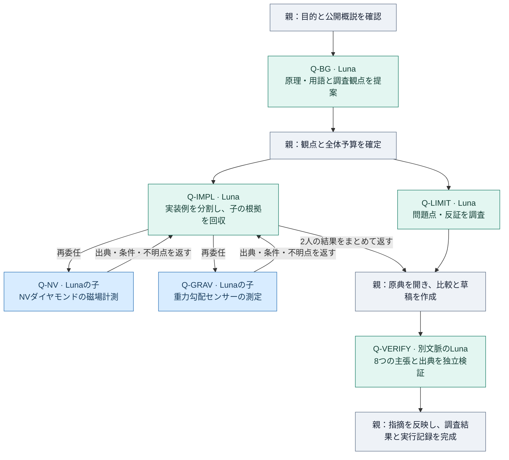

# Luna Research：量子センサー例を6体で実行した結果

確認日：2026年10月14日。READMEの量子センサー例を、実際の公開資料調査として実行しました。**観点の選択、分担、担当から子への再委任、根拠の回収、独立検証、最終結果の作成まで完了**しています。

[量子センサーの調査結果](quantum-sensors-research-2026-10-14.md) / [公開用の実行記録JSON](luna-research-e2e-2026-10-14.json) / [READMEへ戻る](../README.md)

## 最初に分かる結果

| 確認したこと | 実際の結果 |
|---|---|
| 担当モデル | 全6体で GPT-6 Luna / low の完了した初回turnを照合 |
| 分担 | 原理・用語、実装例、問題点・反証、独立検証 |
| 再委任 | 実装担当が自分で2体のLunaを起動し、両方の結果を回収 |
| 起動と予算 | 総起動6、追加依頼0、受入6、未完了0。総試行上限N=6 |
| 同時実行と階層 | 同時最大3体、親から数えた担当の深さは最大2 |
| 出典 | 親が7資料を直接確認。重複を整理すると6系統 |
| 独立検証 | 8つの主張：5件PASS、3件QUALIFY（表現の限定が必要） |
| 実行記録の検査 | 全6体の実行モデル、実際の起動、親子関係、回収、台帳を照合して合格 |

「6体」は親を除く延べ起動数です。実装担当と反証担当、また実装担当が起動した2体の子は、それぞれ実行期間が重なっています。最初の原理・用語担当は、起動経路の確認と調査観点の選択を兼ねて先に完了しました。

## 実際に動いた流れ



図の親の工程は、全て同じ親のCodexです。Q-IMPLは、子への依頼と結果の回収を行った同じ担当です。青い2体が再委任で起動した子で、緑の4体と合わせて6体です。

## ステップ1：未知の分野から調査観点を見つける

READMEの依頼例をそのまま調査目的にしました。

```text
$run-diverse-luna-research
量子センサーについて、まだ何を調べればよいか分かりません。
まず全体像と重要な用語を整理し、背景・実装例・問題点などの観点を選んでください。
観点ごとに担当を分け、必要なら担当がさらにサブエージェントを呼んで調査・検証し、
出典付きの比較と、まだ分からない点をまとめてください。
```

親が公開概説を確認し、Q-BGが定義・用語・主要方式と、調べるべき観点を提案しました。親はそれを基に、原理、実装例、問題点・反証を担当へ割り当て、最後の1枠を独立検証に残しました。

## ステップ2：観点ごとに分担し、実装例を再委任する

| 担当 | 直接の依頼元 | 受け持つ仕事 | 深さ | 最終状態 |
|---|---|---|---:|---|
| Q-BG | 親 | 原理・用語と調査観点の提案 | 1 | 完了・記録照合済み |
| Q-IMPL | 親 | 実装例の分割、子への依頼、根拠の回収 | 1 | 完了・記録照合済み |
| Q-LIMIT | 親 | 問題点・反証 | 1 | 完了・記録照合済み |
| Q-GRAV | Q-IMPL | 重力勾配センサーの測定例 | 2 | 完了・記録照合済み |
| Q-NV | Q-IMPL | NVダイヤモンドの磁場測定例 | 2 | 完了・記録照合済み |
| Q-VERIFY | 親 | 草稿の主張と出典の独立検証 | 1 | 完了・記録照合済み |

全担当を組み込みの `default`、`gpt-6-luna`、`low`、`fork_turns="none"` で起動しました。担当には必要な目的・範囲・資料・予算を渡し、親の選択モデルは変更していません。

Q-IMPLに、同じ全体予算の中から子2体の枠を渡しました。実際にQ-IMPL自身がQ-GRAVとQ-NVを起動しています。各子は、論文の条件・数値・出典・取得できなかった情報を返しました。

## ステップ3：子の根拠を回収し、親が原典を確認する

両方の子の完了記録が、Q-IMPLの最終回答より前に存在することを確認しました。Q-IMPLの実際の起動・待機呼び出しと、最終回答に含まれる子ごとの根拠を照合し、回収記録を作成しました。

親は、その結果と反証担当の資料から重要な原典7資料を開き、最終文章へ採用する主張を確かめました。NISTの複数資料は同じ機関、同じ論文の出版社・著者版・大学要旨は同じ研究として整理し、6系統と数えています。これは6件の独立した性能再現実験を意味しません。

取得できた範囲は、[調査結果](quantum-sensors-research-2026-10-14.md)の各出典と、[JSONの資料一覧](luna-research-e2e-2026-10-14.json)に記録しています。重力勾配の論文本文・著者公開PDFは取得できず、大学の公開要旨で確かめられた数値へ限定しました。検索インデックスだけの詳細な感度・平均時間・試験条件は除外しました。APSの2論文も、取得した公開要旨の範囲で利用しています。

## ステップ4：別文脈のLunaが主張を検証する

Q-VERIFYに、統合した草稿と出典を渡して独立検証を依頼しました。

| 主張 | 独立検証の判定 | 最終文章での扱い |
|---|---|---|
| C1：量子センシングの定義と代表例 | PASS | 出典が支える範囲で採用 |
| C2：NVの読み出しと原子時計の説明 | QUALIFY | 原子時計の表現を公開概説の範囲へ限定 |
| C3：NVの実測136 nT/√Hzと計算86 nT/√Hz | PASS | 実測・計算と画素条件を区別 |
| C4：重力勾配の不確かさ・測線・トンネル検出 | PASS | 公開要旨の数値だけを採用 |
| C5：異なる物理量の数値を直接順位付けできない | PASS | 比較の制約として明記 |
| C6：技術雑音と、量子もつれの利点が得られない条件 | QUALIFY | 特定の雑音・有限資源・局所読み出しモデルに限定 |
| C7：感度以外の帯域・測定時間・領域も必要 | PASS | 比較項目として採用 |
| C8：装置全体の誤差評価と一般的なNIST指針 | QUALIFY | 調査からの解釈と、個別機器の未検証を明示 |

PASSは草稿の主張が出典で支えられるという判定、QUALIFYは適用範囲や表現を限定する必要があるという判定です。親が指摘を反映し、修正後の文章を同じ原典に照らして確認しました。元の5件PASS・3件QUALIFYは保持しています。修正後の文章に対する新しい独立レビューは実施していません。

重力勾配の具体的な装置方式も、親が直接開いた要旨に合わせて「量子重力勾配センサー」と記載しました。比較のチェック項目と装置全体の誤差評価は、調査からの解釈として表示しています。

## ステップ5：実行記録と全体予算を照合して閉じる

Researchの台帳を `synthesis / complete` で閉じ、インストール済みチェッカーへ `--verify-ledger-receipts` を渡して再検査しました。全6体の完了した初回turn、モデル・推論強度、実際の親の起動、親子関係、割当、結果の回収と予算が合格しています。

役割名や自己申告だけではなく、ネイティブの完了した実行記録と実際の起動呼び出しを照合しました。[公開JSON](luna-research-e2e-2026-10-14.json)はこの照合結果の要約です。個人のパス、セッション識別子、raw rollout、認証情報は公開物に含めていません。公開JSON単体で非公開の実行記録を再検査できるものではありません。

## 実行中に直した3点

| 場面 | 起きたこと | 修正と結果 |
|---|---|---|
| 起動前の計画 | 一次資料を調べる終端担当が、N=6に対する必要数2体を満たしていなかった | 検査が起動前に停止。実装例を2体へ分割し、総上限N=6と検証予約1枠を維持 |
| 結果の回収 | 調整担当の回収記録が台帳で未設定だった | 実際の子の完了・起動・待機・返却した根拠から記録を補った |
| 検証後の監査 | 予約枠使用後の監査を通常の起動前検査として指定していた | 新しい起動を伴わない監査へ `--verification` を指定し、最終検査が合格 |

これらは呼び出し方と記録の修正です。調査中にスキル本体、チェッカー、グローバル設定を変更せず、追加起動や予算の拡大も行っていません。

## 今回の確認範囲

実際のResearch手順と成果物の確認結果は **LOCAL_PASS** です。同時最大3体・深さ2は今回の観測値で、プラットフォームの最大能力を測った値ではありません。

実効sandboxは全担当とも `workspace-write` でした。公開Webだけを調べ、編集しないという指示の境界で実行しました。技術的な読み取り専用や、私的資料への安全な委任は実証していません。

量子センサー実験の実機再現、別環境や任意の深さでの再委任、最新の最高性能や製品化、料金・利用枠の削減率は確認していません。論文の数値と、Codexの分業手順が動いた証拠を区別して利用してください。
